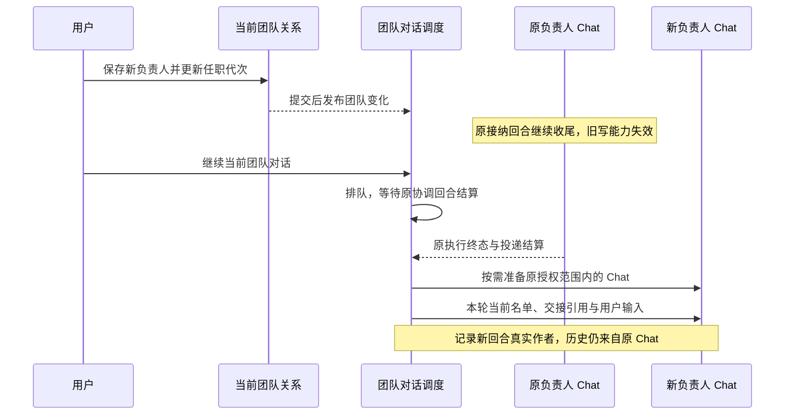

# 团队动态成员与负责人改造方案

状态：待评审方案，尚未实施。

## 1. 目标与范围

团队成员及负责人只有一份当前事实。新增成员、移除成员、调整职责和更换负责人均作用于已有团队对话，不要求用户另开对话。已有聊天、成员执行过程、任务尝试及报告保留原身份。

用户已确认纳入负责人变更，并保留 NeuxBot 的负责人协调、成员执行与报告模式。当前成员决定后续工作资格，成员会话按需准备，每轮接纳使用最新团队上下文。

以下为本方案的工程建议：移除成员取消其尚未完成的执行工作；负责人交接按回合边界串行完成；第一阶段每次新执行提供有界的当前成员上下文，不增加原生 Session 级上下文缓存。这些建议随本方案一起评审。

### 用户可见行为

| 操作                       | 已有团队对话的行为                                                           |
| -------------------------- | ---------------------------------------------------------------------------- |
| 新增成员                   | 名单与 `@` 候选更新；可立即接纳任务，首次执行时准备其 Chat                   |
| 修改名称、头像、角色、简介 | 当前成员视图与下一次执行读取当前公开资料；历史消息作者不被换人               |
| 移除成员                   | 不再接纳向该成员发送、分派、续跑；收敛其运行工作，历史过程及成果仍可读       |
| 重新加入同一伙伴           | 复用该对话中原 Chat；取消的任务不会自动复活                                  |
| 更换负责人                 | 所有已有对话以后续当前负责人协调；历史时间线、消息深链和阅读记录继续可用     |
| 正在运行时加人             | 不重启当前原生会话；CLI 查询和任务提交立即读取当前名单，下一轮提供最新上下文 |

“立即生效”指配置提交后新操作使用新事实，不保证模型在正在生成的同一轮中主动收到推送。第一阶段不自动插入 steering 或唤醒一个空闲团队；用户下一条输入、任务交付或 Agent 主动查询会观察变化。

## 2. 当前问题与设计依据

现有 `ChannelMember` 保存团队成员，`ChannelThreadMember` 在首次发送时复制名单、角色、资料与执行设置，`ChannelThread.LeadWakerID/LeadChatID` 固定负责人。更新团队只修改配置层；任务创建、`@` 校验、CLI 与虚拟 `TEAM.md` 仍使用线程成员。前端导航与执行候选还有两套名单口径。

现有 `TEAM.md` 将完整名单放入稳定指令，并要求 Agent 不再核实；伙伴资料改变还会改变原生稳定指令指纹。根因和实现入口见 [团队协作](../../architecture/teams-cn.md)、[thread.go](../../../server/services/channel/thread.go)、[team_md.go](../../../server/services/channel/team_md.go)、[agent.go](../../../server/services/channel/agent.go)。

团队配置保存当前成员资格，成员退出时收敛已有工作，新任务接纳时复核资格。执行按需准备成员会话，并在本轮输入交付当前团队信息。历史会话继续承担原记录的读取。存储、执行和事件分别复用 SQLite、Chat JSONL、Execution、短期 capability 和统一 WS。

## 3. 权威数据与存储

### 3.1 当前成员与负责人

`ChannelMember` 是成员资格、顺序与团队执行默认值的唯一来源；`Channel.LeadWakerID` 是唯一当前负责人。新增 `Channel.Revision int64`，团队编辑使用期望版本条件更新，冲突后重新读取，不用时间戳充当并发版本。公开资料仍归 Waker，不复制 Bio、RoleName、Expertise 到会话。

成员增加 `Generation`，首次加入生成不透明随机身份；持续在队的成员在完整保存时保留原值，退出再加入生成新值。Channel 增加 `LeadGeneration`，只在负责人身份变化时更新。grant 分别捕获成员加入代次与负责人任职代次，不能仅比较“现在仍是同一个 ID”；这使退出重加或负责人换回都无法恢复旧写权限。普通资料、排序和模型变更不撤销无关成员的现有 Attempt。

移除 `ChannelThread` 的负责人资格字段。接口需要的 `leadWakerId`、可选 `leadChatId` 从当前团队与已有 Chat 映射派生，不再以同名持久字段冻结。线程继续拥有工作范围、标题、任务上限与任务历史；当前成员变更不修改已经批准的目录范围。

线程保存固定的 `ScopeSourceChatID` 授权出处引用，初次准备时指向拥有原 `chat.created` 和 `ProjectSourceSnapshot` 的 Chat。它只用于核对原批准范围，不表示当前负责人或公开消息源。团队拥有的这些 Chat 在伙伴退出或删除时仍归线程，随线程删除才清理；不能因负责人变化或伙伴删除失去授权出处。新成员准备读取这个明确来源，不按当前负责人猜测。

### 3.2 成员 Chat 映射

以 `ChannelThreadContext` 替代 `ChannelThreadMember`，表名 `channel_thread_contexts`：

| 字段                    | 职责                                                       |
| ----------------------- | ---------------------------------------------------------- |
| ThreadID、WakerID       | 联合主键；同一伙伴在同一团队对话内复用一个 Chat            |
| ChatID                  | 唯一、预分配的 Chat 标识                                   |
| ProvisioningID、ReadyAt | 只用于该成员 Chat 的准备与崩溃恢复                         |
| DisplayName、Avatar     | 历史参与者缺失时的展示回退，不参与当前名单、角色或权限判断 |
| CreatedAt、UpdatedAt    | 映射生命周期时间                                           |

该表不含 `IsLead`、成员顺序、职责简介或默认执行配置。存在映射不代表仍是成员；不存在映射也不能阻止当前成员成为 `@` 或任务候选。只读详情与 CLI 不准备 Chat。

已有会话的成员执行设置调整保留为明确覆盖，单独用 `ChannelThreadExecutionConfig` 保存完整覆盖配置，以 ThreadID、WakerID 为主键。只有用户显式调整或历史迁移才写入；未覆盖时每次新执行采用当前 `ChannelMember` 已保存的选择，保持空值与 Fast 三态。移除成员清除其覆盖，重新加入后采用当前团队默认；正在运行的执行继续使用其已接纳配置。

### 3.3 负责人执行归属

新增 `ChannelLeadTurn`，记录 ThreadID、ExecutionID、ChatID、WakerID、ChannelRevision、MemberGeneration、LeadGeneration、CreatedAt。ExecutionID 唯一，同一线程按时间和标识建索引。它仅证明“哪次已接纳执行属于负责人回合及其原作者”，不存执行状态、正文或第二套结果。

`ChannelLeadInput` 与 `ChannelLeadNotification` 记录实际接纳的 LeadChatID、LeadWakerID；报告另保存首次公开投影的 ReportChatID。排队时不绑定未来负责人；执行接纳时才冻结接收方。投递重试仍回到已冻结的原接纳，不能因换负责人重复执行。

具体字段职责：`ChannelTask.AssigneeGeneration` 保存任务创建/显式改派时的接收成员加入代次，`ChannelTaskAttempt.AssigneeGeneration` 在接纳时继承，grant 捕获该值；旧 pending 任务不因成员退出重加而自动恢复。负责人 grant 从该次 LeadTurn 的 MemberGeneration 和 LeadGeneration 恢复；不得读取当前代次重新给旧工作 Mint 权限。`ChannelLeadInput.TargetWakerID` 保存显式用户提及，空表示交给当前负责人，不能只用旧 DirectExecution 布尔值保留路由。`ChannelTaskAttempt.ReportChatID` 在首次报告公开投影前通过条件更新确定，后续通知从 Attempt 引用同一目标；尚未存在 Notification 时也不能丢失该归属。

负责人身份变化不改写任何 `ChannelLeadTurn`、Attempt、消息作者或已经确认的投递对象。该设计避免把“当前协调者”和“历史公开消息来源”绑在一个固定 Chat 上。

## 4. 成员 Chat 按需准备

首次建立团队对话只准备本次真正需要的负责人和显式接收成员，不预建全部成员 Chat。后续任务派发、`@` 发送或打开尚无 Chat 的当前成员对话，通过同一 `ensureThreadContext(ctx, threadID, wakerID)` 路径准备。

1. 使用已有团队聚合锁，读取当前成员资格、线程工作范围与现有映射；退出或不存在的伙伴不能准备新执行空间。
2. 在短事务内预留唯一映射及精确 ProvisioningID；已有 Ready 映射直接复用。
3. 在事务外由 Execution 的成员准备端口创建 cwd、归属标记与 Dormant Chat。新成员继承线程原授权根及 ProjectSourceSnapshot，不重新读取项目配置扩大授权，不启动原生 CLI 或诊断探测。
4. 校验资格和准备身份后标记 Ready。重复准备复用同一 ChatID；失败只回收该准备拥有的私有内容，不操作团队根、shared 或外部项目。
5. 启动恢复在调度前完成未就绪映射的幂等补偿；完成或回收后才能再次准备。不能用首发的“删除整个 provisional team”回滚处理新增成员。

新 Chat 的 cwd 统一使用 `members/<waker-id>/`，不随负责人更换移动。已有 `leader/` 与 `members/` 路径按原 Chat 归属继续使用，禁止为角色切换改 cwd、移文件或复用前任负责人的目录。

## 5. 成员变更与工作收敛

团队保存、伙伴退出及孤儿修复复用同一个成员变化提交机制。通用规范化、名称冲突和 HTTP 输出仍由 API 拥有；共享机制只负责成员/负责人差异、并发版本、工作撤销和提交后事件。

- 新增：仅保存当前关系；不遍历全部历史会话创建 Chat，不自动重新执行任务。
- 伙伴删除或孤儿修复不再因剩余人数不足两人级联删除团队、线程及 Chat。新建团队保持至少两人的当前规则；已有团队允许保留 0/1 人以便补人和读取历史。仍有人时从剩余当前成员中选择负责人，无人时 LeadWakerID 为空并禁止新协调，用户补人后可继续。现有团队编辑表单需支持这一恢复状态，删除团队仍由独立显式删除入口负责。
- 移除：同一事务保存新名单、撤销该成员的新工作资格、处理其 pending 任务及队列，并为 in_progress Attempt 记录带 fence 的取消意图。事务外调用现有取消与监听能力；重启继续推进。取消完成前可以显示正在停止，不能伪报已停。
- `in_review` 已有成果继续保留用户验收；completed、failed、cancelled 及已提交报告不删除。取消上游任务后沿用当前依赖终态规则，不级联取消无关成员任务；负责人根据结果重新规划。
- 任务创建、更新、retry、follow-up、真正派发、用户 `@`、直接成员 Chat 输入及 capability 调用均重新验证当前资格。历史 Chat 可以读，不能绕过团队入口继续给已移除成员发新工作。
- 延迟终态、报告和取消回执仍按 Attempt/fence 提交；移除后迟到成功不能把已取消任务改成完成。已完成成果的通知继续交给当前负责人。
- 移除后又重新加入不能让旧 capability 恢复：移除在提交边界撤销现有 grant，取消 fence 仍生效；重新执行必须获得新 grant。

撤销正确性依赖持久 Generation 与 Attempt 取消事实，每次调用核对；提交后清理内存 Registry 只做及时回收，不作为崩溃恢复的权限依据。原成员被提升为负责人但没有退出时，加入代次不变，其原 Attempt 仍可提交合法报告。

所有变化与派发复用 `teamwork.Acquire`，统一顺序为团队聚合锁、线程调度保护、短事务；不在事务内等待 CLI 或文件 I/O。查询默认单表或索引子查询；成员移除按团队、成员和开放任务状态定向读取，不逐个扫描历史会话。

## 6. 负责人动态交接

更换负责人提交后，所有线程立即解析新的当前负责人，不批量改写线程记录。原 Chat 永久属于原伙伴，新负责人复用自己的 Chat，首次参与时按第 4 节准备。

- 每个线程仍只有一个协调回合席位。旧负责人回合已被接纳时，在原 Chat 收尾；新负责人等该回合终态及投递结算后再接纳，不并发做两份协调。
- 旧负责人仍在团队时可交付已接纳回合结果、读取任务板，但交接后不能继续使用旧负责人 grant 创建、改派、重试或取消任务。若同时退出团队，走成员取消流程。
- 新负责人自己已有成员任务时，只等待该 Chat 正在运行的执行结束；保留已接纳 Attempt 的成员报告权限，不把该 Attempt 追溯改成负责人回合。已经持久化的 pending 任务保留“成员任务”性质，按创建时的成员加入代次与协调回合串行调度；有排队用户协调输入时先接纳协调，再考虑尚未派发的 pending。等待人工验收或依赖条件的任务不占 Chat，也不阻止负责人响应、改派或取消。禁止换任后再创建给当前负责人的新成员任务。
- 更换负责人本身不取消其他成员工作。尚未接纳的协调输入和通知归新负责人；已接纳批次仍由原执行结算，已消费的通知不重复投递。
- 明确 `@` 某个伙伴的排队输入保存目标 WakerID，不因换负责人而转给别人：目标成为普通成员后按成员路径接纳，已退出则显示原输入未交付；普通未指定负责人的排队输入交给当前负责人。
- 新负责人首次协调时收到有界交接上下文：用户本次输入、最近公开完整轮次、开放任务和未消费报告的稳定引用。沿用现有最近五轮及文本预算，不重放全部工具过程；不把历史报告再次写成新消息。只有接纳成功后才确认交接输入交付。

已经持久化、等待原负责人协调回合结束才派发的任务，交接后改为等待“线程已接纳协调回合结束”，不能继续等待原 LeadChatID。排队但未接纳的协调输入不占席位，也不能成为 DeferUntilLeadIdle 的等待对象。新负责人自己的既有成员任务沿用原成员角色执行，与协调回合按上述优先级串行接纳，避免互相等待。负责人执行所需的本地 Runtime 能力仍按有效配置验证；若线程显式覆盖不支持协作能力，返回该配置的准确错误，不静默换账号或模型。

交接边界属于 Channel 编排，不改变原生 Chat 的 WakerID 或会话所有权，不让 ThreadLifecycle 读取团队数据库。

## 7. 公开时间线、报告与阅读

团队公开身份始终是 ThreadID。删除“公开时间线等于当前负责人 Chat 全部消息”的假设。由于不同 Chat 的 CreatedSequence 不可比较，新增 `ChannelTimelineEntry` 引用投影，以 ThreadID、Position 唯一排序，另对线程内公开身份去重；保留 SourceChatID、SourceMessageID、SourceSequence、ExecutionID、真实 WakerID 和输入/报告来源引用，不保存正文或执行状态。

首次公开时在团队事务内分配单调 Position，并向既有 ChannelEvent 写入对应来源引用，投影可从这些引用重建。已排队输入和已持久接纳的助手消息占据稳定位置；从排队输入交接到原 Chat 消息只更新来源，不换位置或公开身份。原生临时增量沿原消息身份合并，不伪造持久序号。Chat 原事实写入后、团队公开引用提交前的窗口由原来源覆盖检查与恢复补齐；覆盖不完整时返回明确不完整状态，不谎报已读或漏掉正文。

1. `ChannelLeadTurn` 给出负责人执行来源；读取对应 Chat JSONL 的原用户/助手消息，沿原 ExecutionID 和 WakerID 保留作者。成员 Chat 中其他执行不能冒充负责人公开回复。
2. 成员报告沿 NotificationID 只公开一次。ReportChatID 一旦确定保持稳定；负责人切换后，历史报告不再复制到新 Chat。新负责人需要的旧成果通过任务引用和本轮交接输入读取。
3. 待投递用户输入仍以原输入 ID 展示，接纳后与真实 Chat 消息交接去重。报告显示及直达规则沿用现有业务事实。
4. 时间线游标为固定的 ThroughPosition 和 BeforePosition，按 Position keyset 分页，然后批量读取页内原 Chat 正文；不枚举所有历史 Chat 或把各 Chat Sequence 混排。原 Chat 的 CreatedSequence 保持原义，新增公开 Position 单独表达团队顺序。历史身份和已有相对次序不得为迁移改变。
5. 团队公开阅读用 `ChannelThreadReadCursor` 保存 ReaderID、ThreadID、ThroughPosition、UnreadGeneration、HoldUnread；逐消息资格沿用共享阅读规则。成员私有 Chat 的游标仍归自身，不与公开阅读重复计数。迁移时按原负责人 Chat 阅读边界转换，保留手动未读代次和 hold；此后团队只写新的线程阅读事实。
6. 看板、铃铛、团队消息页和 IM 读取同一公开引用与位置。更换负责人不会清除未读，也不会让旧消息重新变成新消息；历史深链按原 ChatID/MessageID 定位到公开条目。IM 的线程检查点改用 Position，原投递幂等键继续使用 ExecutionID/报告 ID，不能因换来源重复发消息。自动任务仍以原 ThreadID 及原运行封闭事实追踪结果。

公开引用及其覆盖投影由 Channel 拥有，复用原提交后事件与恢复流程，不另建消息正文存储或全局事件框架。涉及 `timeline.go`、`notification.go`、`channel_thread_controller.go`，以及工作看板、阅读和 IM 的原来源查询，必须一起交付和验证，不能只修团队聊天页面。

## 8. Agent 指令与 CLI

稳定 `TEAM.md` 保留通用协作、任务与报告方法，移出团队名称、工作路径、自己是负责人还是成员、具体名单和当前资料。当前执行角色通过动态上下文及真实 grant 表达，角色改变本身不修改稳定指令指纹。

新增内部 `buildTeamContext(ctx, threadID, selfWakerID, executionRole)`，输出有界 `workinput.Instruction`：当前团队标识/版本、当前负责人、自己本次执行角色、当前可用成员 ID/名称/角色/简介及线程目录。伙伴资料仍批量读取 Waker；使用现有名单长度上限和文本裁剪常量。

负责人首发、普通续聊、成员首次派发、结果通知、任务补充续跑和支持的 steering 都从当前事实构建该动态段。业务用户原文保持不变；同一实际输入中只附加一次，不加入 supplemental 稳定指令或 workspace 文件。

第一阶段每次新执行输入携带这份紧凑的当前上下文。团队目前最多 5 人，每轮直接交付成员信息可以避免判断模型是否收到过旧摘要。后续可依据真实原生 Session、压缩边界和输入交付回执评估优化，只有交付回执才能确认模型已收到上下文。

`botcli team members list` 保留原命令，负责人和执行成员都可只读调用，返回 `revision` 与当前 `items`，角色、资格和可分派性来自当前团队。报告角色授权仍绑定原 Attempt；当前负责人变化不撤销合法的旧成员报告资格。移除“名单权威且不得核实”与“只有名单缺失才查询”的指令。计划分派或怀疑名单变化时允许查询；创建任务失败时返回当前资格与重新查询指引，不要求 Agent 猜名字或重开会话。

## 9. API、事件与前端

团队保存请求增加期望 `revision`。提交后发布一条团队资源变化，携带团队标识和新版本；活动线程的详情与成员查询依赖该团队资源。复用既有统一 WS 和精确失效，不为每个历史会话产生一条成员变更事件，不加轮询。

线程详情中的 `members` 返回当前成员及其当前资料、有效执行设置和可选 ChatID；另提供已有 `contexts` 用于历史消息作者、旧 Chat 深链和过程查阅。历史参与者不混入 `@`、任务分派和负责人选择。GET 没有 ChatID 是合法状态；通过团队入口的显式准备动作取得 ChatID 后再打开成员对话。

团队时间线以 `latestPosition` 替换单个 `leadChatLatestSequence`。在线程路径增加 reading 查询、read 和 unread 操作，语义复用现有阅读命令的观察代次与明确阅读意图；普通 Chat 阅读接口保持原职责。旧负责人 Chat 深链继续映射原团队，不将它解释为当前负责人身份。

前端移除 navigation/execution 两套名单来源：当前成员选择均来自同一有效成员投影；历史过程入口来自消息或 contexts。当前伙伴资料优先，缺失时用历史展示回退。事件只更新成员、角色、设置和状态，不清空时间线缓存、草稿或滚动位置，不新增常驻“快照”“已同步”等标签。

生成模型、OpenAPI、错误与枚举一律走现有生成命令。Web 与 Electron 共享同一 React/API 行为，不新增桌面专属成员状态。

## 10. 旧数据转换与发布

这是一次数据语义转换，不保留运行时的双名单模式。由 Repository 持有专门的旧表转换，Channel 启动时在开放接纳和任务恢复前调用；不在 API/Service 中编写 SQL。停机切换 Core 后再迁移，旧进程不能与新结构混跑。

1. 将旧成员行的 ThreadID、WakerID、ChatID 与展示回退转换为 contexts，保留全部 Chat、日志、文件路径和身份，包含已经不在当前团队的人。
2. 当前资格和负责人直接采用现有 Channel 数据。旧线程中被旧快照遗漏的当前成员无需迁移行，第一次使用时准备。旧快照中退出者不能恢复资格。
3. 旧执行配置与当前团队配置不同的完整配置转为线程显式覆盖，相同则不建覆盖；旧表无法证明差异是原默认还是用户编辑，这个转换选择优先保留旧会话当时的有效设置。退出成员的覆盖不迁入。名称/职责快照不作为当前资料迁入。
4. 固定迁移前公开时间线为转换基线：原 LeadChat 的既有公开内容和待投递输入，按原可见次序建立公开引用/Position，并保留原 ID。记录旧来源及 ThroughSequence 基线引用，使重建不依赖猜测旧编排记录。仅有明确接纳证据的历史执行补 LeadTurn；无法证明角色的既有公开消息按 legacy 来源保留，不能因新的资格规则隐藏旧版本已经公开的内容。必要的旧 JSONL 读取在事务外分页完成，不按当前负责人给旧消息换作者。
5. 检查唯一映射、来源覆盖、任务/通知引用、公开消息 ID/排序、阅读游标转换和文件归属后，以短事务完成结构切换并删除旧成员快照表及线程负责人旧列。采用可重入的分批准备与持久进度；失败不开放接纳，保留原权威日志和可继续转换的数据，不能仅依赖 AutoMigrate 丢列。
6. 新旧数据使用同一资格校验、上下文和调度路径。重启时先完成准备/取消补偿，再恢复任务与交接，不恢复被移除成员的任务。

转换不删除聊天、外部目录、厂商 CLI JSONL 或用户业务文件；公开消息来源无法可靠归类时停止该转换并报告具体线程，不能静默遗漏历史。正式设备迁移前用脱敏历史夹具完成正反检查；本轮只制定方案，不操作真实数据库。

## 11. 实施与验收

按 [实施计划](../plans/2026-11-17-team-live-membership.md) 分为数据与资格、成员准备、动态上下文、负责人交接与公开来源、前端事件、历史转换六个可验证任务。工程顺序先增加目标结构，逐项迁移调用，最后清理旧结构，以保持每步可编译；过渡的旧类型仅供未迁移调用与转换读取，不增加运行时回退分支。跨模块改动按同一产品版本交付，中间结构不作为完成版本发布。

必须通过的用户场景：旧会话加人并立即 `@`/分派；运行中加人不重启原生 Session；移除成员后迟到报告不复活任务；重新加入不重复建 Chat；更换负责人时旧回合收尾、新人接手且只协调一次；新负责人原有成员任务仍可报告；旧消息、阅读位置、IM 输出及工作看板不丢失；断线及重启不漏取消或重复投递。

定向自动化只能证明对应边界；真实 Claude/Codex 连续会话、工作目录隔离与 UI 体验仍需经用户授权后验收。不开运行中的应用、不运行全量检查作为本轮文档任务的一部分。
