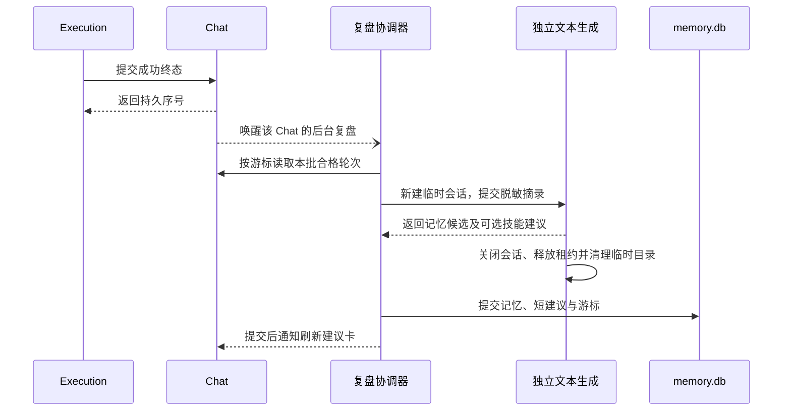
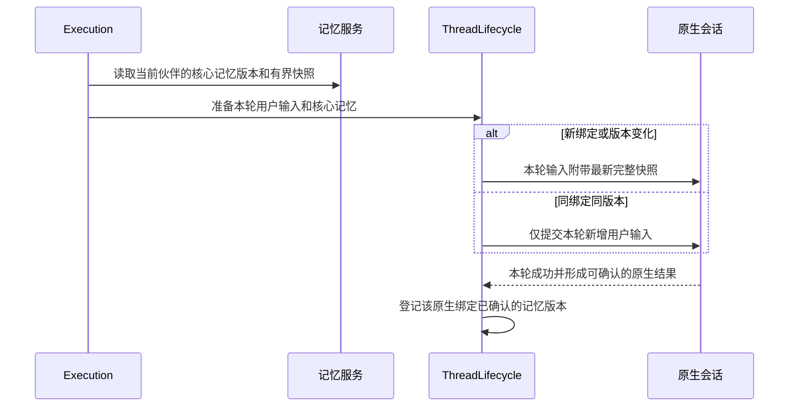

# 伙伴记忆与技能学习前后端设计

状态为设计稿。

## 目标与范围

记忆只归属伙伴。用户在伙伴的记忆页维护长期事实，可以开启自动记忆，并挑选少量核心记忆供新会话和后续轮次使用。项目作为工作目录和上下文来源。项目详情、记忆页、API 和 botcli 都采用同一套伙伴记忆边界。技能学习从对话提取可复用做法，用户采纳后成为伙伴可用的技能。两项功能在智能体设置统一管理。

当前实现由记忆服务维护 `memory.db`、变更历史、FTS5 和可选的 sqlite-vec 语义索引。UI 和 botcli 可以显式读写伙伴及项目记忆。目标架构继续使用这套存储和检索能力，在现有 Chat 成功终态后增加自动复盘，并在普通伙伴聊天的本轮输入中补充核心记忆。 [当前记忆架构](../../architecture/resources-and-memory-cn.md#记忆) · [记忆存储](../../../server/internal/memory/store.go#L111) · [伙伴记忆页](../../../packages/frontend/src/modules/memory/pages/waker-memory-page.tsx#L87)

采用 OpenBot 0.74.0 的两阶段复盘。第一次同轮判断记忆新增、更新、遗忘及技能建议。技能学习按先询问或自动保存模式进入第二阶段，生成新技能或修订已有本地技能。用 NeuxBot 自身的 Chat 持久序号、账号隔离和恢复机制实现。 [源码对照](../../discussions/openbot-memory-skill-comparison-cn.md) · [OpenBot 共用复盘](https://github.com/nightly-labs/openbot/blob/c22549534075806abc2231c54c710474bb870afd/src/backend/agent/memory-review.ts#L384-L443) · [OpenBot 确认后生成](https://github.com/nightly-labs/openbot/blob/c22549534075806abc2231c54c710474bb870afd/src/backend/agent/memory-review.ts#L193-L229)

## 领域归属

| 所有者                       | 职责                                                                                                 |
| ---------------------------- | ---------------------------------------------------------------------------------------------------- |
| Chat                         | 拥有已提交输入、最终正文、执行终态及持久序号。提供按 Chat 读取有界增量的接口。                       |
| Execution 与 ThreadLifecycle | 提交普通聊天成功终态，附加本轮核心记忆数据并管理已交付版本。聊天按伙伴原有设置运行。                 |
| 记忆服务                     | 拥有伙伴记忆、核心选择、变更历史、复盘设置和任务游标。手工维护、botcli、自动复盘共用领域校验和写入。 |
| 独立文本生成                 | 用独立会话处理指定批次，返回结构化候选。账号、原生进程与资源租约沿用 ProviderRuntime。               |
| 技能库                       | 根据技能学习模式创建或修订技能版本，管理唯一发布回执和安装关系。 |
| 智能体设置                   | 管理共用 CLI 来源、伙伴记忆开关与技能学习模式，显示 Core 返回的生效配置及运行状态。 |
| 原聊天                       | 展示非阻塞技能建议及保存状态，转到已保存的技能详情。 |

记忆仍是可跨会话使用的事实和偏好。伙伴档案表达稳定工作指令，技能保存可复用做法，原始消息与产物继续由 Chat 和工作区保存。核心记忆与普通记忆共用一条记录，核心属性只决定是否自动带入上下文。

## 共用复盘

### 触发与输入

- 一个后台协调器按公开 Chat 合并成功终态。每 Chat 保存一个处理游标和一个已触发终态上界。普通用户轮次接纳时记录两项功能各自的资格及代次与当时生效的 CLI 配置版本。调整记忆开关或技能学习模式时仅推进本项代次，从新接纳的合格轮次开始。切换有效 CLI 配置时丢弃旧配置的未完成批次，保留已提交游标，并仅选取新配置下接纳的轮次重新计数。
- 每 Chat 达到配置的合格成功轮次（默认 20 轮），或至少 3 个合格轮次结束后空闲 15 分钟，启动同一个批次。同一轮同时满足两项资格也只计一次。新的前台轮次在途时延迟空闲触发。
- 按冻结的聊天入口和工作范围取证。无目录的普通伙伴聊天可产出两类结果，绑定项目的普通伙伴聊天只参加技能学习。其他入口按规格排除。按消息持久标识标注独立用途，只有自动记忆时构造用户原文及有界相关记忆输入，只有技能学习时只启用技能输出。
- 两项同时有证据时只调用一次模型，结构化返回记忆候选列表和可空的单条技能建议。用户消息之外的技能证据不作为记忆来源。服务端按字段白名单构建证据、验证引用和权限，不直接传送原始事件。用现有伙伴内检索获取有界相关记忆，纳入批次证据总预算，发送经脱敏的正文、标识、分类和只读标记。24 KiB 总预算内为相关记忆和结构化工具步骤分别保留最多 4 KiB 和 6 KiB，按启用功能取用，未使用额度归入对话正文。配置了语义索引时，待保存记忆仍沿用现有 Embedding 配置。

### 一次性会话与清理

每批创建独立临时目录和原生会话，只执行一轮。批次绑定该伙伴当前代次解析出的 CLI、账号和模型，通过 ProviderRuntime 取得相应账号和进程租约。切换来源或修改实际使用的配置时，只推进受影响伙伴的复盘代次并取消其原代次运行。领取批次、发送与提交时核对代次及解析出的配置。模型在内存中返回结构化结果，由 Go Core 校验并提交。两种保存模式的技能生成复用相同临时执行和清理策略。

现有 `GenerateText` 会清理工作目录，但普通独立任务的接纳与终态仍走共享 ConversationStore。复盘接入前须扩展独立生成的存储策略。此策略只用于明确选择临时模式的调用，内存暂存提示、增量和最终原文，避免在公开 Chat JSONL、共享原生 JSONL、诊断日志和失败记录留存该轮输入输出。用量沿用规范终态口径，仅提交实际调用身份、模型、用量和无正文的终态元数据。复盘持久化仅保存任务状态、游标、已校验的记忆和短技能建议，模型提示和原始输出留在临时调用内。 [临时目录](../../../server/internal/agent/detached_task.go#L145) · [当前独立调用持久化](../../../server/internal/chat/conversation/native_stream.go#L968)

所有已接入的智能体都可执行复盘。Core 禁用应用工具和交互审批，并复用智能体已支持的原生配置，例如 Claude 空工具列表和临时会话开关，以及 Codex 只读模式与原生临时线程。Codex 在发送复盘正文前核对临时线程回执。其他 CLI 的原生历史取决于适配器能力。普通独立文本调用仍需要适配器原生禁用工具。成功、失败、超时或取消都关闭会话和客户端，释放租约，再清理受管临时目录。清理失败由 Runtime 保留待回收状态并重试。Core 启动时识别并回收上次进程留下的复盘临时目录，只处理本功能拥有的目录和状态，保护当前租约。

### 调度、写入与恢复

- Chat 在现有持久终态发布点直接向复盘器登记待对账 Chat，内存中按 Chat 合并终态上界。登记先更新集合再唤醒后台，合并唤醒不会丢失已登记的终态。后台只有在处理边界登记成功后才移除相应工作。Core 重启时，等现有 Chat 恢复完成后，用由接纳事实和终态派生的 Chat 查询投影，后台分批补齐已启用伙伴的游标，首次复盘尚无游标的 Chat 同样可发现。投影暂缺的已登记 Chat 按权威日志增量对账或保留待处理。正常运行只依赖提交唤醒、空闲计时和失败重试。 [终态提交与发布](../../../server/services/chat/journal.go#L416) · [现有 Chat 恢复](../../../server/services/chat/recovery.go#L108)
- `memory.db` 按 Chat 保存一个已处理序号和触发终态上界，按伙伴保存记忆开关、技能学习三档及各自代次。批次冻结伙伴、Chat、序号范围、CLI 配置版本和两项资格代次。触发上界内因文本预算拆分的余量继续领取，尾批少于三轮也处理。每次事务只推进到该批最后一个已处理轮次。首版单后台复盘，一次领取一个批次，前台占用所需租约时延迟领取。启动恢复重置中断的运行状态，从已提交边界重新领取。
- 模型返回有界的记忆操作列表及可空的技能建议。操作包含新增、更新和遗忘及本批合格用户消息引用，每个目标最多一项。更新及遗忘同时受模型输入快照与数据库当前修订约束。目标须同伙伴、在本批可编辑候选中、源于自动写入，且未受用户保护或因脱敏隐藏。目标变更后跳过该项，保留其他合法结果。按遗忘、更新、新增顺序应用，在事务内用操作后的正文集合和剩余核心预算做去重及校验。只有仍有核心预算的跨会话事实可新增为核心。更新保留原分类，若导致超预算则跳过。
- 提交前重查设置代次、归属和匹配的相同正文。复盘批次以 Chat、序号范围和配置代次作为幂等身份。有效记忆操作、历史、索引、核心快照版本、短技能建议和游标在同库事务提交，空结果同样推进游标。单项在途失效时只丢弃该项结果。配置了向量服务时，在事务和记忆写锁外准备嵌入，提交时检查索引指纹仍匹配。网络或索引错误使本次共用判定整批重试，游标在结果提交前保持原位。暂时性错误退避重试，持续失败在智能体设置显示原因和重试入口。自动或确认后的技能生成及发布从原建议卡独立重试。
- 执行复盘的授权和提交与原有 Chat、伙伴删除流程共享同归属的短临界区。删除成功后不再授权或接纳该归属的复盘提交。取消在途生成并丢弃迟到结果，已发出的请求按模型服务生命周期处理。伙伴删除清理本伙伴任务及记忆。删除聊天清理其未提交批次，已保存记忆仍按伙伴记忆生命周期管理。
- 用户遗忘条目时，记忆服务推进写入代次并保留该伙伴下的规范化正文摘要。后台重新规划时排除已遗忘的同文事实，用户显式创建同文记忆时可解除该摘要的自动写入限制。

## 核心记忆与普通记忆

伙伴记忆记录保留稳定 ID、正文和历史，增加来源及是否为核心。来源区分用户手工、伙伴命令和自动复盘。自动条目在历史保存来源 Chat、终态区间与引用消息 ID。用户新建条目默认为普通记忆。手工创建或编辑的正文持续受保护。自动复盘条目手动设为核心时受保护，改回普通后重新允许自动更新和遗忘。

核心记忆自动注入普通伙伴聊天的本轮模型输入。普通记忆通过 `memory entries search/get` 按需读取。用户新建和伙伴命令默认保存为普通记忆。复盘新增可在预算内选择核心，用户可以双向切换，同一条目沿用原 ID。两类条目共用伙伴范围内的检索索引。

每位伙伴的核心快照序列化为 UTF-8 后统一限制在 **8 KiB**，包含标识和结构开销。设置、编辑和并发写入在同一事务校验预算，超出时保留原内容和分类。核心条目加入、更新、降级或遗忘推进该伙伴的核心记忆版本。

### 对话注入

- 自动带入限工作台发起的普通伙伴聊天，依据跟随本轮接纳的实际入口和伙伴归属，覆盖其中绑定项目或临时工作目录的会话。首次绑定、原生会话替换、分叉后接续和交付状态未知时发送最新完整快照。同一原生绑定的热续聊只在版本变化时发送。所有核心条目取消时发送空快照，表示当前选择为空。
- 快照作为独立上下文随本轮模型输入交付，用户原文继续使用原生正文块，宿主固定提示仍由[原生会话指令](../../architecture/runtimes-and-accounts-cn.md)统一交付。运行时只记录交付版本及绑定身份，版本确认依赖实际完成且结果已持久化的原生轮次。发送失败或结果未知时，下个正常新轮次可重新交付快照。已送达原生会话的历史输入按该会话生命周期管理，更新和遗忘约束后续交付与检索。
- 前台准备只读有界本地快照，取数失败时聊天继续且本轮不确认交付版本。发送、恢复和分叉保持本地配置核对及实际原生调用，账号状态、额度、模型目录和 Embedding 均不进入核心记忆交付。记忆服务、复盘或可选技能暂不可用时，普通伙伴聊天仍可发送和接续。并行会话共享已校验的技能目录时，待在途轮次结束再切换投影。 [现有本轮输入装配](../../../server/services/execution/native_turn.go#L171) · [执行关键路径约定](../../development/backend-cn.md#82-执行关键路径禁止诊断探测)

### 前端展示

伙伴「记忆」页上方是「核心记忆」，下方是「普通记忆」。分组标题承担分类说明，条目正文沿用现有列表，行内操作提供「设为核心记忆」或「设为普通记忆」。搜索和日期筛选作用于两组，服务端在分页前按分类过滤，两组分别加载。空组保留标题和简短状态。

切换成功后，同一条目从原组移入目标组。键盘焦点跟随可见条目，目标条目受筛选或分页限制时回到目标组标题。预算超限或更新失败时，原组与正文保持可见，并在操作附近显示错误。现有「新建记忆」直接打开伙伴表单，记忆页设置入口跳到智能体设置的「记忆与学习」组并选中当前伙伴。

## 项目记忆退出

- 前端保留现有伙伴记忆入口、搜索、编辑和遗忘。移除项目查询、归属菜单、范围筛选和项目标记。已有变更历史随伙伴范围查询。
- 管理 API 的归属以路由中的 `wakerId` 为准。botcli 的归属来自当次执行授权。去掉 `scope`、`projectId` 及跨范围搜索参数，生成契约和内置技能同时收口。
- 存储、索引和命令回执采用伙伴归属。历史数据迁移、归档与旧回执兼容均不在范围内。
- 项目删除退出记忆清理职责。伙伴删除仍清理自己的记忆和复盘状态。发布目标实现时同步更新领域词汇、资源架构、前端文案和 botcli 契约。

## 智能体设置

共享 React 的 `/settings/agents` 列表页复用现有 SettingsGroup、SettingsRow、账号模型选择器和伙伴查询。「记忆与学习」组显示「使用的智能体」和「整理频率」配置。「配置伙伴」二级页分页列出伙伴，自动记忆及技能学习独立开关，开启学习后可选择先询问或自动保存。展开伙伴时读取实际配置和失败重试信息。语义检索在设置行内展开并复用已有表单及 API。伙伴的资源页提供跳转，单个 CLI 详情页沿用既有导航。

Go Core 保存一套应用级来源、专用 CLI／账号／模型引用和配置版本。按伙伴保存记忆开关、技能学习模式及各自代次。跟随伙伴时用新开普通聊天的默认配置规则，包含应用默认值。沿用生成 REST 客户端、Query 缓存和既有事件连接。读取和保存核对 CLI、账号和模型配置的本地可用性。模型目录在设置中按需刷新，前台聊天路径保持有界本地读取。

## 技能学习

### 建议、取证和保存模式

- 从成功轮次读取用户纠正、最终答复及结构化工具结果。按白名单和脱敏规则构建有界证据，优先保留失败与后续有效步骤。项目对话按技能学习授权读取，独立执行目录只用于临时生成。
- 技能建议包含新建或修订动作、建议名称、一至三句可复用做法和来源标识，修订还需引用本批提供的目标技能及当前版本。服务用有效技能名称和简介判断重复或可修订目标，每批最多保留一项，过滤近期同类建议和已忽略的重复建议。对话内历史只持久化短建议、来源、配置代次和决策状态。
- 询问档由用户在原聊天点击保存或修订，自动档由已提交的建议自动派发，两个入口共用持久任务和同一个发布用例。发现共享修订时转换为带影响范围的确认卡。结果和失败重试仍在来源聊天。建议卡沿用聊天卡片和资源事件，与前台工具审批分别处理。

### 生成与版本发布

- 第二阶段按冻结证据重新验证权限和脱敏，在临时会话生成 `SKILL.md`。修订时向模型提供目标版本的有界正文，等待生成前再次核对版本及安装范围。若原文含不宜外发的数据或超出安全文本预算，保留现有版本并在原聊天显示原因。校验生成结果，保持原技能名称、无关指令和附属文件。
- 新建使用技能库可修订的本地学习来源，在技能库事务发布初始版本、安装到来源伙伴并提交按建议 ID 唯一的回执。修订复用 `CreateVersion` 的期望版本保护和不可变版本文件。写入时重查目标来源、当前版本和安装关系。修订目标可为 ZIP 导入或学习生成的本地技能。Git 同步、内置及插件派生技能采用原更新流程。
- NeuxBot 的独立技能安装关系使用包的共享当前版本。为避免自动学习改变其他伙伴，自动修订只适用于仅来源伙伴安装的本地技能。共享本地技能的确认卡注明受影响的伙伴范围。发布事务重验范围，范围变化则要求重新确认。沿用现有版本回滚入口。 [技能包和安装模型](../../../server/repositories/models/skill.go#L15) · [期望版本校验](../../../server/repositories/controllers/skill_controller.go#L166)
- 同一建议只允许一个保存任务。重启或响应丢失后以回执返回同一技能与版本。生成或发布失败保留可重试建议，版本冲突重新评估目标后才允许继续提交。发布前校验全部有效技能名称，避免安装后冲突。
- 来源聊天删除、自动保留清理及伙伴删除时，通过 Chat 既有排他边界协调结果提交。CLI 配置或技能模式变更使未发布的旧任务失效。已发布的技能和历史版本继续由技能库管理。

## 落地顺序与验收

1. **伙伴归属收口。** 通过真实 API、botcli 和页面测试证明项目入口消失、跨伙伴访问被拒绝。
2. **自动复盘。** 用可控时钟和真实临时数据库覆盖 20 轮触发、至少 3 轮后空闲触发、关闭、两种 CLI 来源、配置切换、重启补齐、模型失败和重试。覆盖绑定项目的聊天、导入或继承历史、删除及并发遗忘。用实际 CLI 核对独立生成的原生工具和历史限制。成功、失败、取消和 Core 重启后检查公开 Chat 与共享原生分片的正文隔离、受管临时目录回收，以及规范用量查询。验证失败时前台聊天继续。
3. **核心记忆。** 验证新聊天、同版本热续聊、编辑、全部取消、失败后重试和原生会话替换。检查没有跨伙伴泄漏，且核心版本更新不会重启热会话或在关键路径引入外部探测。针对 Web 和桌面共享记忆页验证管理行为，按仓库约定独立完成真实视觉验收。
4. **智能体设置与技能学习。** 定向验证「记忆与学习」设置组、伙伴切换、两种 CLI 来源、共用复盘与发布的重试边界及权限检查；覆盖共用判定、项目证据范围、先询问与自动保存、新建与修订、共享修订确认、版本冲突、重复保存、失败恢复、来源删除和回滚。用审阅样例实测 CLI 输出质量、外发内容和落盘行为。
