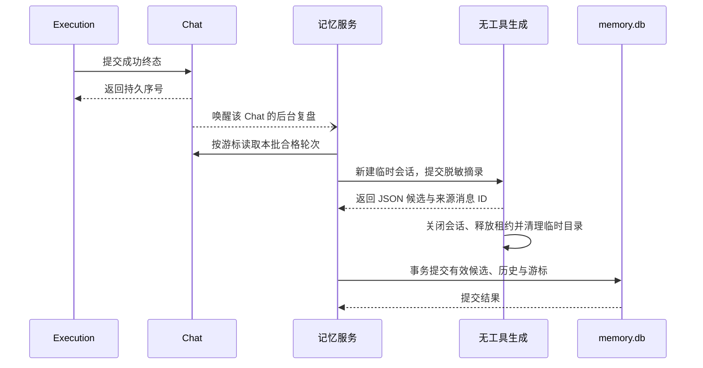
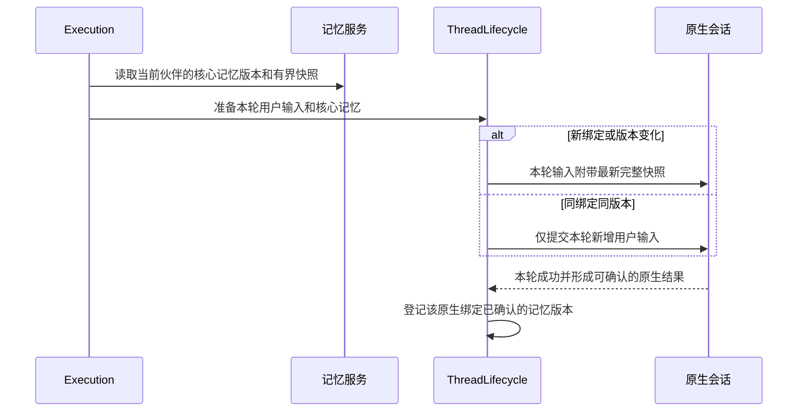

# 伙伴记忆架构方案

状态为设计稿。

## 目标与范围

记忆只归属伙伴。用户在伙伴的记忆页维护长期事实，可以开启自动记忆，并挑选少量核心记忆供新会话和后续轮次使用。项目作为工作目录和上下文来源。项目详情、记忆页、API 和 botcli 都采用同一套伙伴记忆边界。

当前实现由记忆服务维护 `memory.db`、变更历史、FTS5 和可选的 sqlite-vec 语义索引。UI 和 botcli 可以显式读写伙伴及项目记忆。目标架构继续使用这套存储和检索能力，在现有 Chat 成功终态后增加自动复盘，并在普通伙伴聊天的本轮输入中补充核心记忆。 [当前记忆架构](../../architecture/resources-and-memory-cn.md#记忆) · [记忆存储](../../../server/internal/memory/store.go#L111) · [伙伴记忆页](../../../packages/frontend/src/modules/memory/pages/waker-memory-page.tsx#L87)

参考 OpenBot 0.72.0 的会话级轮次、空闲触发、持久游标，以及核心记忆和按需检索的分工。NeuxBot 采用自身的 Chat 持久序号、账号隔离与启动恢复契约。 [后台复盘](https://github.com/nightly-labs/openbot/blob/7183ebd6b0ab6f3fd9c735816fdd952836eae8f2/src/backend/agent/memory-review.ts#L149) · [复盘游标](https://github.com/nightly-labs/openbot/blob/7183ebd6b0ab6f3fd9c735816fdd952836eae8f2/src/backend/agent/memory-review-cursors.ts#L29) · [核心记忆交付](https://github.com/nightly-labs/openbot/blob/7183ebd6b0ab6f3fd9c735816fdd952836eae8f2/src/backend/agent/developer-instructions.ts#L368)

OpenBot 在助手对应的服务商与账号下创建临时客户端，每批新开一个 `ephemeral` 无工具会话，只生成一轮，结束后停止客户端并清理临时目录。NeuxBot 采用相同的一次性会话生命周期。 [OpenBot 临时会话](https://github.com/nightly-labs/openbot/blob/7183ebd6b0ab6f3fd9c735816fdd952836eae8f2/src/backend/agent/profile-generation.ts#L279)

## 领域归属

| 所有者                       | 职责                                                                                                 |
| ---------------------------- | ---------------------------------------------------------------------------------------------------- |
| Chat                         | 拥有已提交输入、最终正文、执行终态及持久序号。提供按 Chat 读取有界增量的接口。                       |
| Execution 与 ThreadLifecycle | 提交普通聊天成功终态，附加本轮核心记忆数据并管理已交付版本。聊天按伙伴原有设置运行。                 |
| 记忆服务                     | 拥有伙伴记忆、核心选择、变更历史、复盘设置和任务游标。手工维护、botcli、自动复盘共用领域校验和写入。 |
| 独立文本生成                 | 用独立会话处理指定批次，返回结构化候选。账号、原生进程与资源租约沿用 ProviderRuntime。               |
| 伙伴记忆页                   | 管理当前伙伴的记忆、核心选择和自动记忆设置，消费现有查询缓存与资源事件。                             |

记忆仍是可跨会话使用的事实和偏好。伙伴档案表达稳定工作指令，技能保存可复用做法，原始消息与产物继续由 Chat 和工作区保存。核心记忆与普通记忆共用一条记录，核心属性只决定是否自动带入上下文。

## 自动复盘

### 触发与输入

- 每个伙伴独立启用，默认关闭。普通用户输入接纳时，Execution 将已启用的复盘配置代次及该轮资格写入现有 Chat 接纳事实。只有当前代次接纳的轮次可复盘，开启前已接纳的在途轮次也排除。关闭时撤销尚未提交的批次。重新开启或更换复盘账号、模型后，从新代次接纳的轮次起算。
- 每个公开 Chat 独立计数。首版在累计 20 个成功轮次时触发，或累计至少 3 个成功轮次且空闲 15 分钟时提前触发。只有成功终态已持久化并具有有效最终正文的用户轮次计数。计时从最近一次符合条件的轮次完成起算，新轮次在途时延迟空闲复盘。
- 自动学习限用户在工作台直接发起、未绑定项目或临时工作目录的普通伙伴聊天。资格基于接纳时冻结的入口和工作范围。建档、档案优化、分叉继承历史、团队、工作流、自动任务与 IM 排除。分叉后新发的合格用户轮次正常计数。带项目或临时目录的伙伴聊天可继续读取伙伴记忆。用户仍可明确要求将一条可跨会话复用的事实保存为伙伴记忆。
- 后台按 Chat 持久序号读取已处理边界之后、目标终态以内的合格轮次。候选初始预算为每批 20 轮和 24 KiB 用户文本，超长轮次在单轮预算内截断。首版只发送脱敏后的用户原文和批内消息标识。助手回复、既有记忆、附件、引用文件、工作区内容和工具记录均留在本地。带引用的用户输入只使用原始消息正文字段。复盘生成的每条事实须能定位到用户消息。
- 每个开启自动记忆的伙伴显式选择复盘账号和模型。独立、无工具的 `GenerateText` 通道当前仅由 Claude 支持，前台聊天仍可使用其他智能体。设置在启用前说明脱敏后的用户消息摘录会发送至所选模型服务。若开启了语义索引，校验后准备保存的单条记忆正文按现有索引配置发送至 Embedding 服务。账号失效或能力不可用时保留待处理进度并显示原因。 [独立生成约束](../../../server/internal/agent/detached_task.go#L70) · [现有模型选择](../../../server/global/knowledge_model.go#L34)

### 一次性会话与清理

每批创建独立临时目录和原生会话，只执行一轮。独立生成继续通过 ProviderRuntime 取得指定账号和进程租约。模型在内存中返回包含正文及来源消息 ID 的 JSON 候选，由 Go Core 解码、验证并提交。模型没有记忆库写入权限，复盘保持无工具，无须为写入结果配置 MCP 或 botcli。

现有 `GenerateText` 会清理工作目录，但普通独立任务的接纳与终态仍走共享 ConversationStore。复盘接入前须扩展独立生成的存储策略。此策略只用于明确选择临时模式的调用，内存暂存提示、增量和最终原文，避免在公开 Chat JSONL、共享原生 JSONL、诊断日志和失败记录留存该轮输入输出。用量沿用规范终态口径，仅提交实际调用身份、模型、用量和无正文的终态元数据。记忆库只持久化任务状态、来源游标、最终采纳的记忆及历史。 [临时目录](../../../server/internal/agent/detached_task.go#L145) · [当前独立调用持久化](../../../server/internal/chat/conversation/native_stream.go#L968)

临时模式也要求适配器关闭 CLI 原生会话的持久化。仅有无工具能力不足以开放复盘，当前 Claude 通道须验证无落盘后才能启用。成功、失败、超时或取消都关闭会话和客户端，释放租约，再清理受管临时目录。清理失败由 Runtime 保留待回收状态并重试。Core 启动时识别并回收上次进程留下的复盘临时目录，保护当前租约，仅清理此功能拥有的目录和原生临时状态。

### 调度、写入与恢复

- Chat 在现有持久终态发布点直接向复盘器登记待对账 Chat，内存中按 Chat 合并终态上界。登记先更新集合再唤醒后台，合并唤醒不会丢失已登记的终态。后台只有在处理边界登记成功后才移除相应工作。Core 重启时，等现有 Chat 恢复完成后，用由接纳事实和终态派生的 Chat 查询投影，后台分批补齐已启用伙伴的游标，首次复盘尚无游标的 Chat 同样可发现。投影暂缺的已登记 Chat 按权威日志增量对账或保留待处理。正常运行只依赖提交唤醒、空闲计时和失败重试。 [终态提交与发布](../../../server/services/chat/journal.go#L416) · [现有 Chat 恢复](../../../server/services/chat/recovery.go#L108)
- `memory.db` 按 Chat 保存已处理序号、当次触发的终态上界，按伙伴保存自动记忆配置及代次。批次冻结伙伴、Chat、序号范围和配置代次。触发上界内因文本预算拆分的余量继续领取，尾批少于三轮也处理。每次事务只推进到该批最后一个已处理轮次。首版单后台复盘，一次领取一个批次，前台占用所需租约时延迟领取。启动恢复重置中断的运行状态，从已提交边界重新领取。
- 模型只返回结构化的新增候选及来源消息 ID。服务在本地校验伙伴归属、来源是否属于本批、正文长度和敏感信息，并按伙伴内的规范化正文去重。已有记忆的更新、合并或遗忘由既有显式操作处理。自动新增默认是普通记忆，用户选择后才成为核心记忆。
- 提交前重查设置代次、归属和匹配的相同正文。复盘批次以 Chat、序号范围和配置代次作为幂等身份。新增、历史、索引更新和游标在同库事务提交，空结果同样推进游标。配置了向量服务时，在事务和记忆写锁外准备嵌入，提交时检查索引指纹仍匹配。网络和索引错误将批次留在可恢复状态，暂时性错误退避重试，持续失败在伙伴设置显示原因和重试入口。
- 执行复盘的授权和提交与原有 Chat、伙伴删除流程共享同归属的短临界区。删除成功后不再授权或接纳该归属的复盘提交。取消在途生成并丢弃迟到结果，已发出的请求按模型服务生命周期处理。伙伴删除清理本伙伴任务及记忆。删除聊天清理其未提交批次，已保存记忆仍按伙伴记忆生命周期管理。
- 用户遗忘条目时，记忆服务推进写入代次并保留该伙伴下的规范化正文摘要。后台重新规划时排除已遗忘的同文事实，用户显式创建同文记忆时可解除该摘要的自动写入限制。

## 核心记忆与普通记忆

伙伴记忆记录保留稳定 ID、正文和历史，增加来源及是否为核心。来源区分用户手工、伙伴命令和自动复盘。自动条目在历史保存来源 Chat、终态区间与引用消息 ID。既有伙伴条目迁移为普通记忆，沿用现有 ID 和可判定的历史来源。

核心记忆自动注入普通伙伴聊天的本轮模型输入。普通记忆通过 `memory entries search/get` 按需读取。新建、伙伴命令及自动复盘产生的条目默认为普通记忆，用户可以双向切换，同一条目沿用原 ID。两类条目共用伙伴范围内的检索索引。

每位伙伴的核心快照序列化为 UTF-8 后统一限制在 **8 KiB**，包含标识和结构开销。设置、编辑和并发写入在同一事务校验预算，超出时保留原内容和分类。核心条目加入、更新、降级或遗忘推进该伙伴的核心记忆版本。

### 对话注入

- 自动带入限工作台发起的普通伙伴聊天，依据跟随本轮接纳的实际入口和伙伴归属，覆盖其中绑定项目或临时工作目录的会话。首次绑定、原生会话替换、分叉后接续和交付状态未知时发送最新完整快照。同一原生绑定的热续聊只在版本变化时发送。所有核心条目取消时发送空快照，表示当前选择为空。
- 快照作为业务数据附在本轮模型输入，保留用户原文和静态指令边界。运行时只记录交付版本及绑定身份，版本确认依赖实际完成且结果已持久化的原生轮次。发送失败或结果未知时，下个正常新轮次可重新交付快照。已送达原生会话的历史输入按该会话生命周期管理，更新和遗忘约束后续交付与检索。
- 前台准备只读有界本地快照，取数失败时聊天继续且本轮不确认交付版本。发送、恢复和分叉保持本地配置核对及实际原生调用，账号状态、额度、模型目录和 Embedding 均不进入核心记忆交付。 [现有本轮输入装配](../../../server/services/execution/native_turn.go#L171) · [执行关键路径约定](../../development/backend-cn.md#82-执行关键路径禁止诊断探测)

### 前端展示

伙伴「记忆」页上方是「核心记忆」，下方是「普通记忆」。分组标题承担分类说明，条目正文沿用现有列表，行内操作提供「设为核心记忆」或「设为普通记忆」。搜索和日期筛选作用于两组，服务端在分页前按分类过滤，两组分别加载。空组保留标题和简短状态。

切换成功后，同一条目从原组移入目标组。键盘焦点跟随可见条目，目标条目受筛选或分页限制时回到目标组标题。预算超限或更新失败时，原组与正文保持可见，并在操作附近显示错误。现有「新建记忆」直接打开伙伴表单，「自动记忆」及复盘模型设置在现有设置入口内管理。

## 项目记忆退出

- 前端保留现有伙伴记忆入口、搜索、编辑和遗忘。移除项目查询、归属菜单、范围筛选和项目标记。已有变更历史随伙伴范围查询。
- 管理 API 的归属以路由中的 `wakerId` 为准。botcli 的归属来自当次执行授权。去掉 `scope`、`projectId` 及跨范围搜索参数。旧项目请求返回明确的输入校验错误，旧项目 ID 在伙伴读取、修改和遗忘入口统一按不存在处理。生成契约和内置技能同时收口。
- Core 在升级开放写入前制作一致性本地备份，保留项目记忆原条目与历史用于回滚。校验新库保留全部伙伴记录、历史与原 ID 后，活跃库只保留伙伴数据及对应索引。备份位于应用数据根的迁移备份区，由升级流程管理。项目记忆不转换为伙伴记忆，备份内容不进入列表、检索、索引或模型输入。升级失败沿用原库并允许安全重试。
- 旧命令回执的身份摘要含原范围参数，统一随旧库备份归档。新命令仅在伙伴归属下生成回执。从升级前中断的旧调用恢复操作时，先通过当前记忆或变更历史确认结果，再决定是否按新契约提交。 [现有命令回执](../../../server/internal/memory/agent.go#L118)
- 项目删除退出记忆清理职责。伙伴删除仍清理自己的记忆和复盘状态。发布目标实现时同步更新领域词汇、资源架构、前端文案和 botcli 契约。

## 落地顺序与验收

1. **伙伴归属收口。** 验证旧库含伙伴和项目数据时升级可重试，伙伴 ID 和历史保留。通过真实 API、botcli 和页面测试证明项目入口消失、跨伙伴访问被拒绝。
2. **自动复盘。** 用可控时钟和真实临时数据库覆盖 20 轮触发、至少 3 轮后空闲触发、关闭、重启补齐、模型失败和重试。覆盖绑定项目的聊天、导入或继承历史、删除及并发遗忘。用实际 CLI 验证独立生成和工具禁用，检查成功、失败、取消和 Core 重启后公开 Chat、共享原生分片及 CLI 历史里均无复盘提示、原始回答或独立会话历史，同时规范用量仍可读取。验证失败时前台聊天继续。
3. **核心记忆。** 验证新聊天、同版本热续聊、编辑、全部取消、失败后重试和原生会话替换。检查没有跨伙伴泄漏，且核心版本更新不会重启热会话或在关键路径引入外部探测。针对 Web 和桌面共享记忆页验证管理行为，按仓库约定独立完成真实视觉验收。
