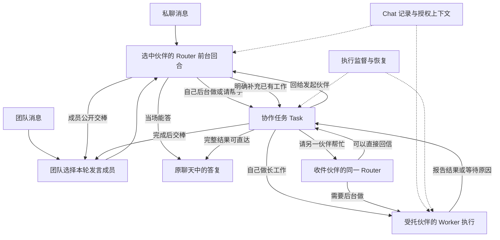

# 私聊与团队的伙伴协作设计

2026-11-20 · 设计提案 · 实施基线为 NeuxBot 当前主线工作区，行为参照 OpenSuperAgent。

## 1. 用户会怎么用

**私聊选中一个对接人，团队选中一组可以一起工作的人。** 两处的伙伴都能直接回答、自己后台做、请伙伴帮助，并沿发起位置交回结果。团队额外决定谁可以参与、谁接着发言、哪些成果需要验收。建议从主线已有的团队派工和回报代码里抽出这条共用路径，让私聊也能调用它。[源码与核对范围](2026-11-20-unified-partner-collaboration-sources.md)

| 用户操作 | 私聊 | 团队 |
| --- | --- | --- |
| 发“帮我对比两份资料” | Lumi 接收。能当场答就直接答，耗时工作放后台，用户可另聊 | 默认负责人接收。可以点名成员，也能由负责人安排成员分工 |
| Lumi 需要 Mira 的帮助 | Lumi 把具体问题和必要材料交给 Mira，Mira 回给 Lumi。Lumi 在原私聊答复 | Mira 必须是本线程成员。可交给她下一轮公开发言，或请她后台做完再交接。群内保留真实作者 |
| 用户怎么跟进 | 原聊天的工作摘要能打开详情、补充和查看执行过程 | 共同时间线能看到交给谁、谁交回、谁待验收，另可进入线程内的成员 Chat |
| 谁交付 | 原对接伙伴负责。自己后台做完可直接带回成果，帮手的回信由对接人收取 | 沿用现行的单项完整报告直达规则。需要多项汇总时由负责人交付 |

**本次范围是普通私聊和团队。** 上游是交互和流程的参照，后端由现有 Chat、Execution 和 Channel 演进。已有工作流、IM 和自动任务继续按主线契约运行，只验证共用代码改动对它们的兼容性。

## 2. 整体架构

OpenSuperAgent 在致谢中明确写出，Router、Worker、Watchdog 和 Inline & Spill 的架构思路来自 DeepSeek Super-agent。**每位 Bot 有自己的 Router，Worker 随任务启动，服务共享一个 Watchdog 巡检各 Bot 的任务。**群聊先选谁说话，再进入那位 Bot 的 Router。同一位 Bot 私聊时能做的直接回答、后台派工和接收回信，在群中仍由它自己的 Router 决定，群另外规定接手范围与顺序。[上游致谢](https://github.com/kadaliao/open-super-agent/blob/c217b8e0dcaaa40bb865febad2deeba483d0e1cd/README.md#L169-L176) · [上游总图与消息流程](https://github.com/kadaliao/open-super-agent/blob/c217b8e0dcaaa40bb865febad2deeba483d0e1cd/docs/architecture.md#L3-L34)

**Ticket 是理解这个设计的业务概念。** DeepSeek 的公开原型把一次已获授权的委托建成 Ticket，持续保存目标、输入、回复地址和执行分配。OpenSuperAgent 的实现更轻，Router 派工时用派工消息的 ID 创建 `Task`，记录目标、Bot、Chat、状态，以及可选的回信或交接地址。运行对象留在进程，派工和结果写入会话消息，详细步骤另存可独立清理的任务日志。本设计取“同一件事可以跨回合继续负责”的语义，代码统一称**协作任务 Task**，采用现有 `taskId`。重试、收补充和等帮手回信都继续使用同一任务，只有实际执行换代。[DeepSeek 原型的 Ticket 定义](https://github.com/deepseek-ai/dsh-superagent-prototype/blob/8c32a9dc5d72c033816c6a8110b37f40cf94fba4/src/core/model.ts#L271-L307) · [OpenSuperAgent 的 Task](https://github.com/kadaliao/open-super-agent/blob/c217b8e0dcaaa40bb865febad2deeba483d0e1cd/osa/worker.py#L26-L59)

下图是 NeuxBot 的目标架构。实线表示谁把工作交给谁，虚线表示上下文读取与执行监督。



| 架构职责 | NeuxBot 首版放在哪里 | 这个边界解决什么问题 |
| --- | --- | --- |
| **Router** 决定本轮如何处理 | 在当前伙伴的 Chat 回合注入伙伴角色、同来源可见工作及获准工具，由这一次模型调用作答或发动作。Core 从已绑定的真实执行验证并接纳动作 | 同一个伙伴在私聊或团队复用这段行为。无需为路由再启模型，也无须建立全局指挥伙伴。主线仍按 Chat 管原生执行位 |
| **工作单 Task** 保存谁答应做什么 | 共用仓储由主线 `ChannelTask` 演进。保存目标、来源、受托人、回复路径和当前状态，尝试归原任务 | Router 可以在派工后结束前台回合。用户继续发消息、换一次执行或重启 Core，责任仍查得到 |
| **Worker** 在授权范围内把工作做完 | 复用 `Execution.Start(WorkIntent)`、工作 Chat、ThreadLifecycle/Turn 和 ProviderRuntime。一次尝试关联一次真实执行 | 伙伴是长期身份，Worker 是它本次承担的执行角色。Lumi 可以自己开后台，也可以让 Mira 当受托人。私聊其他消息仍有前台位置 |
| **Groups 与回信** 决定谁下一轮收到结果 | 团队层校验名册、发言顺序、验收与直达。协作层读取任务创建时的回复位置，投递到原 Chat 或唤醒当时的发起尝试 | 接力、回信、完整结果直接交付分别有明确去向。团队范围在转手时依然有效 |
| **Watchdog** 观察工作是否还能推进 | 上游有独立循环检查超时、停滞、重复工具调用与预算。NeuxBot 首版将监督放在共用协作服务，复用原生终态、精确取消和重启对账。出现明确错误或达到已配置硬时限才通过 Execution 处理。单纯缺进度先展示原因，人工审批与等回信单独计为等待 | 监督者不签发任务、不判定成果合格。各 CLI 可观测能力不同，缺少工具进度不能推断发生死循环或自行重派。[上游监督规则](https://github.com/kadaliao/open-super-agent/blob/c217b8e0dcaaa40bb865febad2deeba483d0e1cd/osa/watchdog.py#L32-L59) |
| **Inline & Spill** 决定本轮带哪些上下文 | 上游将最近消息内联，更早内容只留带编号的索引，可按会话读原文。NeuxBot 保留原生热续聊和已有历史接力，对新增的协作上下文只传目标、必要近况和已有消息或产物引用，用宿主能力按权限取全文 | 让帮手获得完成工作所需材料，避免把个人或其他团队的整段历史复制给它。读引用沿用已有 ID，权限以来源和本次工作范围为准。[上游上下文选择](https://github.com/kadaliao/open-super-agent/blob/c217b8e0dcaaa40bb865febad2deeba483d0e1cd/osa/memory.py#L160-L180) · [NeuxBot 聊天与执行](../../architecture/chat-and-execution-cn.md) |

**一个架构判据。** Lumi 在私聊接到“找两份资料”，或在团队被点名接到相同请求，都由 Lumi 的 Router 决定当场回答还是派后台。若派工，共用服务建立同一种 Task，Worker 在同一执行底座工作。区别发生在进入 Router 之前的选人，以及结果出来后的发言与交付。若某个实现要求团队另建 Worker、私聊另建派工表，或每次进群都通过一个独立主智能体转述，就没有达到这一目标。

例如 Lumi 请 Mira 核对一份资料，上游由 `dm.wake` 唤醒 Mira 的 Router。Mira 能直接回就回，需要工具长时间工作才再派 Worker。我们的方案同样保留收件伙伴的判断，同时把这次有明确回信义务的求助记为一件 Task，供重启后查找收件人和原地址。Mira 接手时若转后台，沿用这件 Task。单纯在群里把发言交给 Mira 则无需写工作单。[上游应答与回信选择](https://github.com/kadaliao/open-super-agent/blob/c217b8e0dcaaa40bb865febad2deeba483d0e1cd/osa/router.py#L329-L349) · [私信唤醒](https://github.com/kadaliao/open-super-agent/blob/c217b8e0dcaaa40bb865febad2deeba483d0e1cd/osa/dm.py#L87-L111)

### 2.1 负责任务归属的也是 Router

任务卡上的“补充”和“停止”携带已有 taskId，宿主核验来源后直接交给目标。普通聊天里用户接着说“刚才那两份再补上日期”，Router 根据本对话可见的活动工作决定补充哪一项。有两个可能目标时先问清。用户另问无关问题照常直接答。前台能看见工作的简短标题、受托人和状态即可，查详情时再读原任务。团队兼容入口的明确点名继续遵循第 5.3 节约定。数据库更新、派发次数与恢复由 Core 裁决，模型无需复述内部执行身份。

### 2.2 前台可采取的动作

| 上游实际行为 | 在 NeuxBot 如何实现 |
| --- | --- |
| 私聊直接进入该 Bot 的 `respond`。群先选发言人，再调用同一个 `respond` | 私聊由当前 Chat 确定伙伴。团队从线程和提及确定伙伴。两者把已解析的伙伴、实际 Chat 和本轮准许的动作交给同一 Execution 入口。直接回答只需原有的一次模型调用。[Router](https://github.com/kadaliao/open-super-agent/blob/c217b8e0dcaaa40bb865febad2deeba483d0e1cd/osa/router.py#L318-L347) |
| `dispatch(goal)` 让当前 Bot 自己的 Worker 去做。派工消息 ID 就是任务 ID | 伙伴亲自转后台时建一件工作，立即返回原会话。公开派工记录和任务详情共用该任务 ID。后台使用单独可定位的执行 Chat。[派工代码](https://github.com/kadaliao/open-super-agent/blob/c217b8e0dcaaa40bb865febad2deeba483d0e1cd/osa/router.py#L719-L739) |
| `message_bot(to,text)` 让另一 Bot 收到请求。宿主记住该回给谁。接收者直接答或派后台，回信都能沿原路返回 | 私聊里把帮手、问题及回信位置落盘，回信由 Core 路由。在 NeuxBot 同一伙伴可以有多条私聊，不能用“该伙伴最后打开的聊天”当目的地。[私信与回信](https://github.com/kadaliao/open-super-agent/blob/c217b8e0dcaaa40bb865febad2deeba483d0e1cd/osa/dm.py#L40-L80) |
| 群里 `handoff` 让成员接着说。`dispatch(handoff_to)` 先做工作，成功后才叫下一位。群中用户点名有顺序，未点名通常由协调者接 | 团队用持久的发言队列安排这两种交接。后台成员仍可并行。上游允许群外私信，我们按用户决定把团队协作全部限定在线程成员内。[群发言](https://github.com/kadaliao/open-super-agent/blob/c217b8e0dcaaa40bb865febad2deeba483d0e1cd/osa/groups.py#L23-L56) · [完成后交接](https://github.com/kadaliao/open-super-agent/blob/c217b8e0dcaaa40bb865febad2deeba483d0e1cd/osa/groups.py#L106-L156) |

三个动作的区别值得直接写进工具说明。**自己做**把长工作交给自己的后台，**请人帮忙**约定收件人和回信位置，**交棒**只安排谁接着在群里发言。交棒可以只有一句话，单独交棒无需建任务。当接手者自己决定耗时工作需要后台时，才产生任务。

## 3. 主线从哪里改

主线已经共用 `Execution.Start(WorkIntent)`。普通聊天的首发与续聊、团队负责人和成员的原生执行最终都走这条路。差别在它上面。普通私聊缺少派工与回信入口。团队已有领取、尝试、补充、报告和投递，但 `schedule` 一开始就读 ChannelThread，`dispatchTask` 通过 thread 找成员 Chat，`ClaimForDispatch` 按 thread 计算限额及停止状态。私聊无法直接复用这段代码。[执行入口](../../../server/services/execution/intent.go) · [团队调度](../../../server/services/channel/task.go) · [原子领取](../../../server/repositories/controllers/channel_task_controller.go)

建议抽出一个小的 `services/collaboration` 包。入口只需能顺着读下去的四段代码：解析本轮伙伴，接纳协作动作，启动获准执行，处理结果。普通回答直接经过第一段进入原 Chat 的 Execution。只有工具实际提交了后台工作或求助才走后三段。不要为了识别意图，先让另一模型给每条消息分类。

下面的伪代码表示业务调用顺序。当前回合由 Core 从真实执行绑定取得，模型只提供动作的业务参数。

```text
收到私聊消息 → 当前伙伴.respond(原 Chat, 消息)
收到团队消息 → 团队选出下一位 → 同一个伙伴.respond(本轮 Chat, 消息)

dispatch(目标)           → 建工作给自己 → 后台执行 → 回原会话
ask(伙伴, 问题)          → 建工作给伙伴 → 收到回信 → 发起伙伴继续回答
handoff(成员, 说明)      → 将成员排为下一位发言人
dispatch(目标, 接手成员) → 自己后台做完 → 将成员排为下一位发言人
```

| 代码所有者 | 具体职责 |
| --- | --- |
| `services/chat`、`services/execution`、`internal/agent` | 消息权威日志、唯一活动执行、实际账号/权限、原生接纳、取消、释放与结果。引用它们的现有回执 |
| 新的协作包及 Repository | 从 `services/channel` 的 `task.go`、`lifecycle.go`、`member_report.go`、`notification.go` 抽取任务领取、尝试、补充、工作终止与稳定回信。团队和私聊调用同一实现，单一恢复入口 |
| `services/channel` | 团队配置、线程接纳、线程成员 Chat 映射、选发言人、依赖、预算、人工验收和最终交付策略。将这些判断和已解析目标传入共用路径 |
| 私聊入口 | 标明原 Chat 和当前对接伙伴，为自己或获准帮手准备隔离工作 Chat，选择“直接交付”或“先回原伙伴” |

## 4. ID 怎么减

**通常模型只需给出“交给谁、做什么”，用户只需点原消息或任务。** 下面的身份由 Core 维护。源码里当前一次任务尝试会在相邻两行生成 `attempt.ID` 和 `attempt.ExecutionID`，随后用后者启动一次执行，这是可以实际删掉一次随机生成的地方。[现有尝试创建](../../../server/services/channel/task.go) · [尝试的唯一约束](../../../server/repositories/models/channel_task.go)

| 身份 | 首版决定 | 为什么 |
| --- | --- | --- |
| `wakerId`、`chatId` | 直接复用。一个标识伙伴，一个标识对话。私聊来源就是当前 Chat，团队公开来源就是该线程的负责人 Chat | 同一伙伴可以同时是两个团队的成员。按伙伴 ID 无法把结果送回原会话 |
| `channelId`、`threadId` | 团队配置和一次团队会话各保留原 ID。通过现有成员 Chat 映射查 thread，通过 thread 查团队，私聊没有这两个字段的业务值 | 编辑团队模板和停止某一场团队对话会影响不同范围。模型发一次求助无需传这两个 ID |
| `taskId` | 每次实际派工或求助生成一个。新建派工消息若显示，直接用该 taskId 作为消息 ID，详情和跟进也用它。普通消息、纯交棒均不预建任务 | 一条用户消息可以派两件事，两件事要能分别停止。不能直接把原用户消息 ID 当成两件工作的 ID |
| `executionId`、旧 `attemptId` | 新的后台尝试只生成一次 32 字符标识，同时填尝试主键和预留的 executionId。重试换一次 executionId，taskId 保持。旧行继续按各自保存的两个值查询 | 历史深链、报告和取消必须命中当时实际的执行。预留 ID 也不代表原生已接纳 |
| `fence` | 保留现有整数代次，与 taskId 联合标识第几次有效领取。由系统附在能力或用户验收表单中 | 若第一次执行晚交报告，第二次已开始，必须能拒绝旧报告。它无需再有一个 UUID |
| `clientRequestId`、`submissionId`、工具 `requestId` | 各自沿用现有协议。一次用户提交只生成一次提交键，首发与普通续发按各自入口映射。工具重传使用该次工具请求键 | HTTP 重传同一条消息与一个模型回合内独立派两件事需要区分。正文相同也可能是两次真实请求 |
| 来源、回信与发言 | 用已存在的原 Chat、可选的发起尝试，以及发言触发消息/位置表达。权限主体由宿主已绑定的真实执行推导 | 不为一条工作另外发明全局会话号、根工单号、分派号、回信链号或跟踪号 |
| 结果消息、通知、验收与流程外身份 | 同一尝试同一类型同一目的地的投递复用稳定身份，已有公开消息沿用旧 ID。不同事实保留区分。IM 回复绑定和 Workflow Run ID 留在原领域 | 一条成员报告和之后用户批准验收是两件事。把两者都改成 taskId 会吞掉批准通知或把结果发错渠道 |

**一个例子。** 用户在私聊 C 发消息 M，Lumi 请 Mira 查资料。Core 建任务 T，派工记录和详情都指向 T。Mira 第一次运行用 E1，用户明确重试后用 E2。E1 的迟到报告因代次不匹配被忽略。Mira 的结果按 T 中保存的原 Chat C 回给 Lumi。普通界面需要“资料核对”这一项，以及能点开的真实执行记录。只有排查重试时才需要看 E1/E2。

命令的正常签名可以保持为 `dispatch(goal)`、`ask(partner, question)`、`handoff(member, note)`。其中 `dispatch` 可带一个本队的完成后接手者。可选的 `taskId` 只在用户或模型明确补充、取消已有工作时出现。CLI 展示名称供人选择，Core 校验稳定伙伴身份。重名时选定真实对象，不能靠再猜一次名称来派工。

## 5. 三条可以从头跟到尾的流程

### 5.1 私聊直接答与自己后台做

1. 用户通过现有首发或续发接口进入所选伙伴 Chat。保留提交键、附件、目录、账号、模型、能力选择与普通草稿行为。简单问答照常结束。
2. Lumi 调用 `dispatch` 时，服务端从已接纳的当前 execution 取真实来源。用发起执行、具体操作与既有工具 requestId 查回放。同键同内容返回原工作，同键异内容报冲突。一个事务建立工作、冻结目标和必要输入、提交工具回执。工具结果返回 taskId，前台结束本轮。
3. 调度器为 T 使用 Lumi 的独立工作 Chat 和受管目录。可复用现有 dormant chat / 隐藏历史能力，工作 Chat 按任务稳定绑定，断线重试回到同一位置。同一期间用户可在原 Chat 问另一件事。
4. 后台报告和原生终态齐备后，把完整成果投回原私聊。完整结果可直接显示，不额外启动 Lumi 再复述一次。公开 Chat 忙时结果已持久待投，等空闲再投。用户可从摘要直接看状态，关闭页面不会取消已接纳的任务。

### 5.2 私聊请另一位伙伴帮忙

1. Lumi 调用 `ask(Mira, question)`。本机用户普通私聊的首版默认可找其他可用普通伙伴。只传请求、用户明确允许的附件与必要资料。为空或受限的能力集继续收窄，外部来源和隐藏工作 Chat 不能冒充本机入口。
2. Mira 在与这项工作绑定的 Chat 收到请求，用自己的账号、伙伴配置和可用工具处理。Mira 与用户已有的私聊可能有多条，也可能有私密历史，因此不把求助自动塞进其中一条。回复目的地从来源冻结。
3. Mira 短答就直接结算本次请求。若把工作转后台，可沿已经与用户聊天隔离的工作 Chat 和同一 taskId 继续，只有新的独立工作才分配新 taskId。若再请 Jun 帮忙，Jun 的任务只保存发起这次求助的 Mira 尝试 ID。用它就能查出上一跳的任务、原 Chat 和代次。Jun 回 Mira，Mira 再回 Lumi。Mira 的尝试结束并释放执行位，任务保留为“等回信”。到了该继续的时候，在 Mira 原任务下开新一次执行。私聊链深建议首版采用上游的 5 跳，并拒绝向当前请求祖先循环求助。
4. 最终回信投到原 Chat，并以稳定提交键唤醒 Lumi 一次，由她回答用户。公开来源删除、权限撤销或工作被明确取消时，停止后续唤醒并保留对应原因。绝不就近投递到该伙伴的其他私聊。

### 5.3 团队点名、接力与交付

1. 没点名由负责人接。现有单人点名、团队首发接纳和失败补偿保持兼容。新多目标点名按消息中显式顺序去重，候选只取当前线程已接纳的成员。团队配置后续更动不自动开放旧线程。
2. 用同一伙伴执行入口运行本轮。已有旧客户端的单成员 `@` 仍按当前行为，忙时补充原任务、空闲时可建直达项。新“公开交棒”只安排另一成员发言。两者在 Core 各有明确动作。用户选择工作流与显式点名的现有互斥规则保留。
3. Lumi 可以直接 `handoff(Mira, 请核对结论)`，也可 `dispatch(查资料, 完成后交给 Mira)`。前者只等 Lumi 当前公开发言结束。后者先让后台做完，在当前结果成功且需要的验收通过后才安排 Mira。失败或取消写明原因，解除等待。只有完成后交接这一原因时撤去该席位。还存在用户明确点名时保留原点名，成员可说明缺失的材料。同轮里 Mira 已有尚未领取的点名席位时，把前置工作挂到那个席位，保留她在队列中的位置。如果有多份明确要求等待的工作，就等这些工作均成功。尚无席位时才建一项。如果 Mira 已经实际发过言，后来明确要求她基于新结果接手，这是同一预算中的新一轮。投递同一份旧结果的重试只复用原席位。
4. 每个线程同一时刻只允许一位公开发言人。后台工作仍遵守原 MaxParallel、成员 Chat 单写、依赖、优先级和失败次数限制。成员工作时不占公开发言席。负责人和被点名成员自己做长工作时，释放承载当前公开回合的 Chat，必要时在任务绑定的工作 Chat 运行。既有正式团队任务继续使用其线程成员 Chat。
5. 负责人 Chat 是共同时间线的持久来源。成员的公开短答按真实作者，以稳定 ID 通过 `AppendParticipantMessages` 投递。持久日志确认后才推进下一位。成员完整执行留在自己的工作记录。一个触发回合的公开发言上限建议取上游的 8 次，达到上限后等待新的用户输入，已派后台工作继续按自身状态结算。
6. 正式团队任务保留原报告、验收和直达规则。负责人空闲、线程无待办或运行中/待验收项，且当前尝试仅一份完整、未截断、策略允许并由成员确认可直达的报告时直接交付。其余报告由负责人汇总。完成后明确指定接手人的中间成果先交接，直接向用户交付与唤醒汇总只能选择适用的一条。

**团队名单在每个入口都生效。** 团队内可公开交棒，也可派正式工作给同队成员。通用求助动作若用于团队，按团队规则记具名委派和返回原线程，不能建立群外私信。Core 解析 Chat 是否属于团队，包含成员标签和从深链进入的工作 Chat。模型工具目录、接单、派工和投递分别核验同一来源。群外目标即使重名、在个人名单中、或通过普通聊天 HTTP 路径提交，也无法收到群里的资料。

## 6. 存储、并发与恢复

**保留团队现有物理表和主键。** 首版建议扩展 `channel_tasks`、`channel_task_attempts` 和 `channel_task_follow_ups`，在 Go 层抽出中立任务仓储。现有团队任务原地读取。团队依赖、线程成员、人工验收和团队事件继续由 Channel 管理。私聊不会为复用这些表而创建团队、虚拟负责人或假 thread。

| 需要持久化的事实 | 实现决定 |
| --- | --- |
| 工作从哪来 | 为任务添加 `sourceChatId`。私聊为原公开 Chat，团队为线程的负责人 Chat。团队兼容字段 `thread_id` 保留，私聊用空值。旧团队行按已有线程的 LeadChatID 回填。用户实际触发消息保留其原 messageId，与派工 ID 分开。工作 Chat 关联到 task，成员标签从现有映射反查所属 thread |
| 做什么、交给谁、回给谁 | 复用任务的说明、发起人、受托人、输入和状态。保存接纳时的动作种类（自办、求助、正式团队派工），据此决定顶层结果直接显示、唤醒原伙伴或由团队结算。旧行按原团队派工解释。增加可空 `replyToAttemptId`。为空时走本来源的交付策略，非空则通过它读取上一跳任务及其发起时的 fence。写入和唤醒都验证同一来源。成功后交棒另存可空的接手成员。后台续办保存原工作 Chat 以便重开同一项工作。按需关联即可从任一跳还原来路 |
| 一次尝试发生了什么 | 沿用现有 TaskAttempt、原 Chat、预留 executionId、代次、接纳和结束事实。工作已登记、真实执行已启动、操作已实际停止、用户已收到各自可查。成员在同一轮提交完全相同的报告可重放，冲突内容拒绝 |
| 谁下一轮说话 | 团队增加轻量持久发言队列。每项用 `(触发消息ID, 轮内序号)` 作键，保存成员、原因、前置结果和发布状态。无需独立发言 UUID。属于同一触发的延迟交棒继承原轮预算，其他用户消息可在等待后台期间发起新轮。选公开发言人时线程内原子占一席，待发布结果到达负责人 Chat 后清席 |
| 哪个结果还要投递或唤醒 | 复用团队已采用的“先落通知、再追加 Chat”模式。共同仓储以 `(原任务, 尝试代次, 动作种类, 明确目的地)` 唯一。首次生成或派生稳定公开消息键并保存，重试拿回同值。若还要唤醒原伙伴，在该行先固定接纳键，发送后按原键对账。团队既有报告/批准通知用存量消息身份，沿用其来源聚合与 IM 绑定 |

**帮手回信只消费一次。** 帮手完成后，用保存的发起尝试读回父任务及 fence。父任务仍在等这次尝试交出的工作才可接收。父任务已人工重试、停止或换代时只保存旧尝试的历史结果。若同一尝试发出多份请求，收齐这批成功、失败或取消的回执后，由一次条件更新把父任务从“等回信”变成待运行。重复结果不会唤醒第二次。一份请求失败时把原因交回发起者判断。为任务新增这一明确等待态，父 Turn 正常退出只释放席位，任务终态判断要优先识别仍有未答请求。

**一套领取路径。** `schedule` 取来源下可运行的工作，按团队或私聊策略过滤，再由 Repository 在同一事务中检查状态、代次、接收者占用及限额，创建尝试并领取本批输入。团队延续每线程和每成员的检查。私聊用非空 sourceChatId 分区，不允许用 `WHERE thread_id=''` 把所有私聊算成一个队列。同一活动聊天仍受 Execution 自身的真实准入约束。新增私聊后台用按来源公平的有界总并发，建议缺省 3 席，等待帮手回信释放席位。旧团队的线程预算独立沿用。建议一个来源同一伙伴同时最多一个后台尝试。前台接待走原聊天执行位置。

**输入与目录。** 原私聊始终保留其项目与 cwd。私聊后台默认写自己的任务目录，接收获准的附件、工作副本或已发布资料，成果从原私聊取回。用户明确选择要直接访问的项目时，Core 仅把原来源已经授权、实际执行方也获准使用的目录及权限交给现有 Execution。显式要求原位修改但运行时无法按授权开放时，报告阻碍，不把改了副本当作改了原件。两个 Chat 同时拥有同一真实可写目录时，主线的 Chat 单写不能提供目录互斥。有前后顺序要求的原位修改通过显式先后派工，团队沿用任务依赖。首版不新增全局项目锁，也不临时更改普通前台的工作目录。验收分别覆盖隔离目录可并行、用户授权的原位写入，以及缺乏权限时的真实反馈。

**重启只看已有事实。** 先读原任务、代次和 Chat 提交回执。已接纳的运行补绑定并观察原 execution。确认从未接纳的操作可用同一提交键继续。有可能已经在原生进程或外部产生副作用、又找不到确定回执时，标识该次尝试待核实，只允许查原记录或用户明确处理。状态留在本次尝试，迟到回调不能修改更新代次。团队回报、公开发言和私聊回信都先写持久投递意图。Chat 忙时 `AppendParticipantMessages` 会拒绝，本次留在待投队列，收到空闲/恢复事件再试。消息已经写进 JSONL 而投递状态未更新时，按原消息 ID 对账。唤醒已接纳也按原提交回执对账，避免第二次启动模型。[Chat 的实际投递约束](../../../server/services/chat/participant.go)

**停止与删除。** 用户停止一次聊天回复，使用原 chatId/executionId 精确取消。停止一件后台工作使用 taskId，Core 查当前代次并取消其执行和因该工作尚待唤醒的后续请求。已有其他独立工作继续运行。整线程停止保留既有待验收项。正式删除 Chat 前核对仍归它投递的工作和受管目录，只清理自己拥有的文件。首发、续聊、恢复、分叉和增补均沿用现有本地配置及真实调用，不增加账号状态、额度或模型目录探测。

## 7. 客户端、工具与现有调用方

- **聊天页面。** 普通私聊无协作时照常显示。派工后在原消息附近展示工作摘要，从“更多”进入现有右侧工作台的分页列表，再进任务详情或原执行 Chat。首次查询摘要只读。返回时保留原会话、滚动和草稿。不增加独立助手入口。团队保留主时间线、成员标签、具名贡献与验收。
- **工具授权。** 当前 `team.tasks.*` 和 `team.reports.submit` 作为兼容入口调用同一后端。新增私聊派工/求助和团队交棒都通过现有 capability 注册和实际 execution 绑定。线程成员快照验证“此人能否参加”，尝试上实际的 ChatID、executionId、fence 和动作绑定验证“本次能否操作”。主线目前会在成员标签 Chat 查询活动 execution，需将新后台回合改为核验实际工作 Chat。负责人自办通过新的 `dispatch` 进入，旧 `team.tasks.create` 继续只分派给非负责人成员。团队汇总轮只读，成员报告只能操作当前尝试，人工验收仍由用户处理。受理与工具回执在同一事务提交。
- **API。** 现有 `/chats`、`/channels` 的首发、续发、成员任务、验收、取消保留。私聊来源下新增只读任务列表/详情和针对 taskId 的控制，服务端反查公开来源和可见性。私聊与团队共用任务详情投影和业务命令。团队管理保留 threadId，界面按原契约导航。
- **事件。** 复用提交后的事件、现有 `/api/v1/events` WebSocket 和 HTTP 补读。公开消息按原 Chat 序列，团队事件按原游标，页面没有额外轮询。普通未提交草稿、已入库的协作请求、结果待投递三种状态各给真实反馈。工作看板读取来源，私聊工作归原聊天，隐藏工作 Chat 不另占一条公开会话。
- **外部入口。** IM、自动任务、工作流在本期继续从主线各自的现有入口接纳、完成和取消。不得因启用了本机私聊天然接待能力就给这些入口开放后台求助。本期新增的团队交棒只向本机用户的团队回合开放，外部原有团队委派通过共用写端保留原有运行、IM 绑定和工作流权限。

## 8. 实施顺序与兼容

| 顺序 | 交付切片 | 达标条件 |
| --- | --- | --- |
| 1. 先在团队里拆出共用派工 | 提取领取、执行、回报和投递。Channel 传线程资格与策略。旧接口、表、ID、事件保持可读，先只处理团队 | 团队首发、依赖、人工验收、已有报告直达与汇总、IM 来源、精确取消、重启后未投通知的结果与改前一致。全程同一任务只有一个调度者 |
| 2. 私聊先做“我自己去做” | 原 Chat 能调用 `dispatch`，为工作准备隔离 Chat，任务卡使用同一个 taskId，后台结果回到原私聊 | 真实 CLI 能在前台回答另一问题时继续做原任务。一次短答只产生一次原生前台执行。关掉客户端再进仍能找到原工作 |
| 3. 私聊再做“请 Mira 帮我” | 加收件和回信规则、来源范围与受限的工作目录。支持直接答和后台答，两种均回原伙伴 | 同一伙伴在两个私聊同时求助，交错回信均回到正确来源。私聊 A→B→C 能逐跳返回。重复工具调用、迟到结果、来源删除均可验证 |
| 4. 团队接入同一组动作 | 团队成员可在本队派工和接棒。增加按序点名和完成后交接，前端原时间线显示真实作者 | 多人点名与“工作完成后交给下一人”相遇只实际唤醒一次。群外目标在列表、工具、Core、详情回读均不可达。现有负责人验收/汇总保留 |

数据转换放在首个需要新字段的切片中。备份副本先演练，按主键游标分批从线程回填公开 Chat，再按稳定键重复运行校验。已开始、待验收、未接纳的预留、完成与取消分别抽样。旧尝试主键和 executionId 永不重算。无法找到线程或负责人 Chat 的历史行保留原数据并列出，禁止猜归属。所有全局 `ListPending`、`ListInProgress`、恢复扫描、看板计数、删除清理和外部来源读取必须在启用第一条私聊工作前完成作用域改造。旧团队 writer 先停止启动，由同进程内共用 writer 接管，才允许启用新入口。新旧调度器不能扫描同一库并发派工。

回退以关闭**新动作的接纳**为界。现有 writer 继续处理已接纳工作和待投回执。团队任务仍按原身份访问。写过私聊任务后，原版会全库扫描待派任务，不能直接把旧二进制接回该数据库。实施须有最低可读版本检查和保留共用只读/恢复能力的回退构建，并验证已投递结果不会因回退重复。整个过程不要求搬迁聊天日志或重编号历史任务。

## 9. 验收场景

| 场景 | 必须看到的事实 |
| --- | --- |
| 日常问答与后台长工 | 普通回答无任务记录，无额外分类模型调用。后台自办保留原 Chat 的交互能力。前台停止只命中用户点的 execution |
| 两种会话共用伙伴前台 | 同一伙伴在私聊、团队各接一次相同目标，记录发言伙伴、路由动作、任务领取与真实执行。两次走同一任务服务和 Worker，只在成员资格、公开发言与交付目的地出现预期差异。单纯交棒没有后台工作单 |
| 任务归属、监督与上下文 | 两项工作并行时，显式补充只进入指定任务，口头补充归属不明时先澄清。等人审批或等回信期间不误判停滞。真实执行中断只对账原尝试。长资料能由获准 Worker 按原引用取回，同一链接从另一团队读取被拒 |
| 多个 ID 是否真能省 | 新派工仅生成一个 taskId，新尝试仅生成一个执行标识。用户同一条消息派两件事得到不同任务。重试保持 taskId 并更换执行 ID。旧数据中两个 ID 不同仍能查历史、投报告和精确取消 |
| 回信去向 | 两个同名伙伴、同一伙伴的两个私聊、同一伙伴在两个团队，均按实际身份和来源送达。一次短回信与一次后台回信均只唤醒发起方一次 |
| 团队发言与并行 | 无点名、按序点两人、即时交棒、后台极快完成、后台失败、待验收、多名成员并行、轮次上限分别覆盖。公开发言有序，互不冲突的后台工作可并行，群外伙伴零接收 |
| 故障与越权 | 在任务事务后、原生接纳后、Chat 写入后、唤醒接纳后分别重启。实际执行数和可见消息数符合预期。原生结果未知时不重发。撤权、旧 fence、猜 taskId、越目录、错 IM 绑定均被拦截 |
| 数据与客户端 | 用有真实旧结构的 SQLite 和 Chat 日志演练迁移/回退，核对旧深链、报告、待验收和分页。侧栏不出现隐藏工作 Chat，桌面和 Web 均能从摘要回到原执行，断线后通过现有事件与 HTTP 恢复 |

实现阶段先跑受影响的 Chat、Channel、Repository 与前端具名测试，再用同一构建做私聊回信与群内接力的原生 CLI 实测。记录原消息、工作、实际执行与最终可见回复即可复核一条链。主线兼容、模型行为、视觉验收分别记结果。
