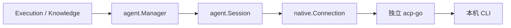

# Agent 子系统

Agent 位于 `server` Go module 内。应用装配一个 Manager，为聊天、独立文本生成和工具任务提供同一会话机制；业务接纳、授权和持久化归原领域，Session 唯一拥有执行与资源生命周期。模型推理和工具循环由本机 CLI 负责。

## 职责与调用

下图只表示主要调用方向；领域资源经装配端口取得，接口实现关系不混入调用图。

| 对象 | 唯一拥有的事实 | 边界 |
| --- | --- | --- |
| Manager | 工作区索引、临时 Session 登记、接纳门禁、根生命周期及待清理所有者集合 | 不复制 Session 的 busy、兼容摘要、句柄或释放状态 |
| Session | 稳定计划、兼容依据、当前 Turn、原生句柄、连接、实际资源及释放进度 | 一个 Session 同时最多一个 Turn，不管理其他 Session |
| PreparedTurn / Turn | 同一回合的准备占位、Context、输入、事件、交互和有界最终候选 | PreparedTurn 直接持有 Session 与 Turn，不包装另一套执行内核 |
| Catalog | 安装、Profile、程序定位、已有探测事实及 Probe/Fork 编排 | 不拥有聊天终态，不在每轮聊天做远端健康或授权预检 |
| native.Connection | 一次原生 Agent、ACP 传输、原生会话、通知与取消 | 不接收产品计划或领域资源获取回调 |
| native.LaunchLease | 冻结启动环境、认证刷新入口、凭据对账和可重试释放 | 原生消费者退出后才关闭，不读取业务数据库 |
| capability.Registry | 精确授权、撤销、在途调用和有界观察 | 业务状态及事务内回执归原领域 |

根 Agent 与 native 不导入 API、Service 或 Repository。native 不反向导入根 Agent、capability 或 cli。根 Agent 只在原生连接边界转换计划和输入；产品错误使用 `status_error`，原生边界保留结构化技术 Fault，并在产品入口转换一次。

## 三个模型

- **SessionPlan**：窄 SessionTarget、模型、工作区、固定指令、技能和 ConnectorDeclaration 等稳定事实；类型排除秘密环境、刷新回调和连接器请求头，不携带本轮输入。
- **TurnInput**：本轮正文、附件、代码引用、资源选择、有界历史播种和交互端口。本轮软件授权只在冷资源取得时并入启动资源，热轮更新既有稳定连接文件；它不进入兼容摘要或模型可见静态身份。
- **SessionResources**：实际 RuntimeTarget、账号、插件、技能、完整连接器、业务快照及释放能力。业务层从同一资源所有者回读接纳所需事实，不另建热资源表。

新建、恢复、真实原生句柄和只读交接由 SessionDirective 表达。静态配置与句柄一致时才能复用热连接；配置改变先关闭旧消费者，再取得冷资源。新会话只播种一次有界完整历史，热续聊和冷恢复只发送新增消息，不生成自制 Checkpoint。

## 准备与执行

1. Execution 冻结 SessionPlan 与准备指令，调用 `Manager.PrepareSession`。Manager 找到唯一 Session，由 Session 占用本轮并判断复用；Prepare 不启动原生进程。
2. 热准备沿用原连接及资源。冷准备由调用方使用 `PreparedTurn.Context()` 顺序取得账号、插件等领域资源，再调用 Bind。首次有效冷 Bind 立即接管实际或部分资源，随后校验和启动租约准备失败也由同一 Session 清理；重复或已消费句柄的 Bind 不接管新资源。
3. Execution 回读实际插件和范围等具名事实，形成接纳所需数据；`Run(TurnInput, EventSink)` 此时才打开必要连接并提交本轮输入，Bind 不提交 Prompt。
4. `native.Connection` 经独立 acp-go 与 CLI 通信。普通聊天收到真实 PromptAccepted 后，Agent 转为 InvocationStarted，Execution 提交消息和执行事实并返回 API 接纳结果。
5. 原生消息身份、阶段和完成证明交给 Turn 的有界收集器判断最终答案；产品事件交给 Execution 的实时投影与完整消息日志。审批和问答经本轮端口往返。
6. Agent 返回结果，由原领域保存终态及续接事实。执行状态、答案可用性、事件交付失败和清理失败分别表达；Session 按结果与留存策略保留或关闭消费者。

`GenerateText` 与 `ExecuteTask` 由同一个 Manager 登记临时 Session，复用同一 Prepare / Bind / Run 机制；两者按任务类型取得显式资源，执行后关闭，不创建 Chat 或聊天日志。严格最终输出和无人交互是本轮策略，模型工厂在提交前确定，失败后不切换或重放输入。

## 事件预算与参数快照

Turn 默认限制单个规范事件为 1 MiB、本轮累计计费为 64 MiB，离散事实与无进展通知合计上限为 16,384。数量预算用于接纳、消息身份与明确阶段及完成、工具身份与标题／类别／状态／位置变化、工具完整结果、用量和交互。空通知、重复参数或状态等没有新增载荷的通知仍逐条计数；完成通知即使夹带正文也保留独立边界。

同一身份下的连续正文、思考、参数替换快照及工具追加纯文本不按原始小包次数扣减数量预算。每个原始通知仍完整计入单事件大小与固定处理开销，参数只抵扣同一调用的重复前缀，其他正文和结果均完整计入累计量。规范字符串按实际字节和固定标量开销计费，每条事件固定开销仍为 32 字节；这些用量不等同于 JSON、ACP 传输或聊天日志的文件大小。

Session 同步交付全部原始事件，不增设计时合并队列，也不改变原始顺序、正文或终态。其最近工具事实与最终候选的身份集合受数量上限约束，保留载荷受字节上限约束；原生传输排队、观察者交付期限、人工等待期限和无活动期限各自保留。单事件过大使用 `FRAME_TOO_LARGE`，本轮离散数量或累计载荷耗尽使用 `EVENT_BUDGET_EXCEEDED`，两者通过结构化预算原因区分。

工具 Input 是同一调用身份下的完整替换快照。累计计费只抵扣它与该调用紧邻上一份参数相同的字节前缀；新增和改写的参数、独立工具身份以及其他全部载荷仍完整计费。清空或缩短参数不退还已用预算，随后重建仍计新增字节。工具正文、结果、状态、位置及其他事件不参与抵扣，观察者始终收到完整事件。参数计费依据与观察者取得的副本隔离。

隔离重建已将 Execution 的消息持久化移至新 Turn 的[耐久缓冲](../agent_next/delta_buffer.go)，[产品消费者](../../services/execution/native_turn.go)不再另写正文和用量。旧 Agent 本文保留为迁移基线；候选当前验收及未完善项见 [Codex 优先验收](../../../docs/discussions/agentruntime-rebuild/codex-first-acceptance-cn.md)。

## 用量观察与最终交付

`native.Usage.Reported` 保留 acp-go 当前 Prompt 的累计消费快照，消费与上下文独立替换，通知与最终回执不相加。缺少最终回执、原生失败、取消或交付失败时仍返回此前有效观察；无元数据的旧数字不伪造字段缺失性或完整性。来源、分类及 Provider 支持以[用量快照](../../../docs/architecture/runtimes-and-accounts-cn.md#用量快照)为准。

Session 对流式事件与最终观察者交付均深复制 Usage 及其可空计数，观察者不能改写权威结果。最终交付在当前 Turn 释放前使用独立五秒期限，继续受同一个 sink 的单事件、累计字节与事件数预算限制；超限保留结果中的消费和原停止状态，将交付故障单独记录，不重放 Prompt。

产品 `UsageData` 保留既有 turn/context 数字与新快照声明。公开 `Result.Usage` 是同一 Session 最终事实的独立快照，消费和上下文已按分量替换；流式事件供实时观察，Execution 统一序列化终态快照并随唯一正常收尾归档。非 nil 的空快照明确表示没有已知用量，不能回填旧观察；仅旧 Runner 的 nil 结果兼容既有 sink 快照。终态交接不新增事件，不绕过预算，不重复累加。未知历史、失败和取消回放及继承身份的本地验证见[用量基础验收](../../../docs/discussions/provider-runtime-parity/usage-foundation-acceptance-cn.md)。全局去重、统计和费用不属于 Agent 的快照职责。

## Context、授权与关闭

取得准备句柄后，调用方立即登记 Close。冷资源取得受准备 Context 取消约束；取消不能遗弃仍可能返回的资源，迟到部分结果仍经 Bind 交还 Session。成功冷 Bind 和热准备返回前解除短接纳 Context 的取消转发，Run 使用执行 Context；接纳请求结束不能取消已经交给后台的执行。未运行冷准备回收，未运行热准备保留原消费者。

人工输入和审批由 Execution 的同一待办事实交付，默认等待五分钟；用户处理、期限到期、原生请求撤销、所属 Turn 结束或应用关闭均结束等待。期限到期分别报告等待回答超时或等待审批超时，不与模型请求超时、整轮期限或用户取消混淆。接纳决定由 Execution 协调器串行化，截止前已接纳的决定不会因后续持久化或发布跨过期限而改成超时；原生无活动计时器在真实原生交互或宿主未决问题存在时暂停，处理后重新计时。观察者交付期限、事件预算与无人交互策略独立保留。已提交的交互处理事实由 Chat 完成查询投影和通知发布，原交互 Context 的取消不撤销这些提交后职责。

同一 Session 的取消、关闭、Prompt 完成与交互返回有唯一线性化点；不同工作区和独立任务可以并发。Manager 的集合锁不覆盖原生 I/O、账号等待、事件回调或资源清理。账号与插件管理通过 Manager 请求各 Session 在同一会话锁下检查闲置状态；活动调用返回 Busy。

本轮能力授权在 Prompt 返回或取消时撤销，连接文件、技能、账号等会话资源继续保留至原生消费者退出。关闭顺序为原生 Connection → LaunchLease 的刷新入口与凭据对账 → 任务文件及领域资源 → 临时工作区。成功步骤不重复；失败保留同一消费者和剩余依赖，阻止替代消费者绕过失败，只重试清理，不重新提交 Prompt。清理故障不覆盖已经取得的答案。

`Manager.Start` 显式启动每 10 秒一次的临时任务清理重试，只处理执行已结束且没有当前 Turn 的临时 Session，不关闭活动或正常留存的聊天。独立任务的活动与待清理所有者合计上限为 64，聊天不计入此上限。应用退出停止新接纳，取消并等待准备、执行和后台清理，再关闭闲置及清理未完成的所有者；超时返回关闭错误，可对同一 Manager 再次 Close。

Probe/Fork 经 Catalog 使用无 Prompt 的独立 `native.Management`，共享唯一 Descriptor、原生工厂和 LaunchLease。关闭失败同样保留管理连接及账号、目录依赖；原生位置、耐久分叉回执和 ReconcileOnly 沿原协议核对，未知结果不重复派发。

## 阅读顺序

1. [Execution 接纳](../../services/execution/work.go)、[资源取得](../../services/execution/session_resources.go)与[执行收尾](../../services/execution/lifecycle.go)：接纳、授权、日志和业务终态。
2. [agent.go](agent.go)：Manager、聊天准备、独立文本/工具任务及根关闭；[contract.go](contract.go)定义唯一产品合同。
3. [session.go](session.go)：Session、PreparedTurn、Turn 的兼容、绑定、执行、输出、交互和清理。
4. [resources.go](resources.go)：原生工作区、插件环境、启动租约与领域资源装配；[catalog.go](catalog.go)和[config.go](config.go)维护目录、探测与配置规则。
5. [native/connection.go](native/connection.go)：一次原生连接与协议；[registry.go](native/registry.go)维护唯一 CLI 声明、工厂和厂商输入差异；[launch.go](native/launch.go)和[management.go](native/management.go)维护认证及管理连接。
6. [capability](capability/)保存同源命令 Schema、授权、观察和回执；[cli/cli.go](cli/cli.go)负责 allycli 解析与客户端。

业务边界见[智能体与账号](../../../docs/architecture/runtimes-and-accounts-cn.md)，消息链见[聊天与执行](../../../docs/architecture/chat-and-execution-cn.md)。自动化测试、真实 CLI/账号/模型及平台验收分别提供证据，结构与契约检查不代表真实模型验收已经通过。
