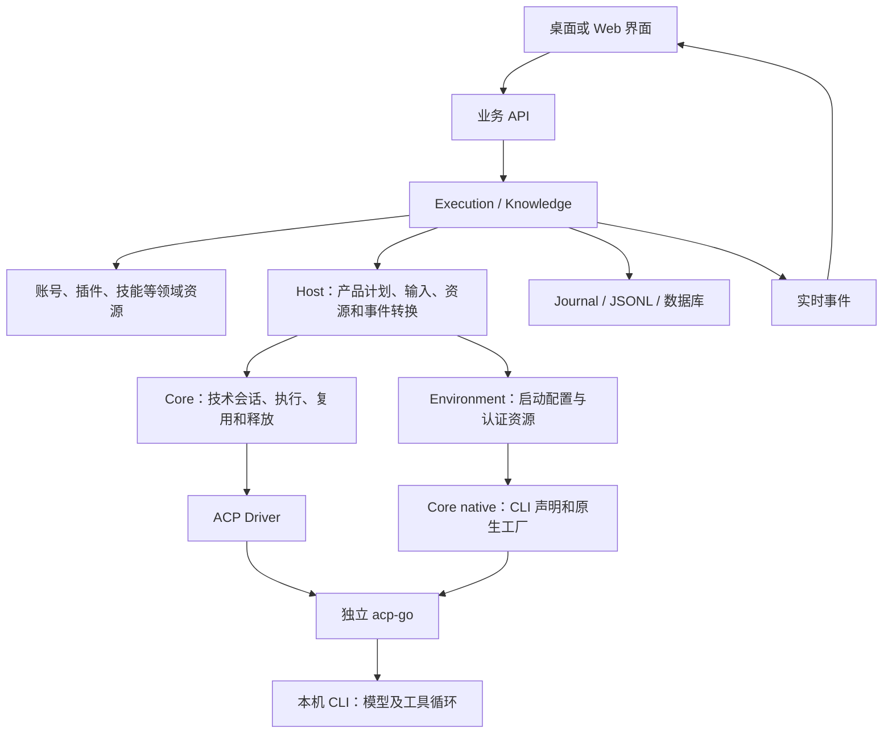

# Agent 子系统

Agent 位于 server Go module 内，为聊天和独立任务提供同一准备及执行流程。业务接纳与持久化归原领域，技术会话与资源生命周期归 Core，产品转换归 Host，启动和认证装配归 Environment。

## 职责与依赖

| 模块 | 拥有的职责 | 边界 |
| --- | --- | --- |
| core | 技术会话、活动调用、静态兼容、执行、取消、输出和释放栈 | 不读取业务数据库，不识别伙伴、知识库或插件授权 |
| host | 产品模型转换、工作区与 Runtime 关联、交互及事件适配 | 不复制技术会话状态，不保存完整请求作为热资源 |
| environment | 安装发现、探测事实、启动配置和认证装配 | 不拥有聊天及执行终态，不在每轮聊天做远端预检 |
| Execution / Knowledge | 接纳、本轮能力、领域资源取得、日志和结果 | 不持有原生连接，不另建技术会话表 |

Core 不依赖 Host 或 Environment；Host 通过 Driver 工厂使用统一启动器。Environment 的 launch 使用公开的 native 工厂构造原生实例。厂商协议和进程实现仍归独立 acp-go。

## 三个模型

- **SessionPlan**：窄 SessionTarget、模型、工作区、指令、ConnectorDeclaration 等稳定事实；类型不包含认证环境、刷新回调、关闭策略或连接器秘密。
- **TurnInput**：本轮正文、附件、代码引用、资源选择、唯一历史播种及交互。本轮软件授权提供 LaunchEnvironment，只有冷资源取得时并入启动资源；热轮更新原有稳定连接文件。它不进入 Core Prompt 或兼容摘要。
- **SessionResources**：实际 RuntimeTarget、账号、插件、技能、完整连接器及释放能力；认证环境、刷新和强制关闭事实只在这一资源边界。业务事实具名表达，不以 Data any 或完整请求回填。

新建/恢复、真实原生句柄、只读交接和消费者留存是准备指令。Runtime 不生成或消费自制 Checkpoint；稳定配置兼容仍由 preparationKey 判断。普通聊天允许保留热消费者，独立任务及只读交接要求本轮结束关闭。

## 一次聊天

1. API 进入 Execution，整理本轮输入，冻结 SessionPlan 和准备指令。
2. Host 转换会话声明，调用 Core.Prepare。Core 占用会话，判断热复用；配置不兼容时先关闭旧消费者。
3. 热路径沿用原资源；冷路径由 Execution 使用准备 Context 顺序取得领域资源，再调用 Host.Bind。Host 共用启动装配生成 Driver 和 launch 资源，Core 接管包括部分失败结果的释放责任。
4. Execution 读取具名插件和范围事实，构造接纳记录；Run 显式接收 TurnInput，冷路径此时才打开原生连接。
5. Driver 提交 Prompt。普通聊天收到 PromptAccepted 后，经 Host 转成 InvocationStarted，Execution 提交用户消息和执行事实并返回 API 接纳结果。
6. 过程事件经 Core → Host → Execution，分别进入实时投影和完整消息日志；审批、提问经本轮端口往返，不由 Core 解释业务。
7. 最终结果交回业务层保存终态和续接信息。Core 按能力、执行结果和留存策略保留消费者，或按依赖顺序释放。

独立文本生成与 Wiki 工具任务使用相同的 Prepare → 冷取得资源 → Bind → Run；输出只消费任务结果，按任务类型注入显式资源，不创建 Chat 或聊天日志。

## 所有权与关闭

Host 只保留工作区到 Runtime 的关联。Core 持有活的技术 Session、Driver、原生连接和资源释放栈；业务层只持久化原生句柄供冷恢复。账号配置和凭据仍归账号服务，插件安装及授权仍归插件领域，launch 仅装配其启动资源。

准备调用方立即登记 Close，并用准备 Context 取得资源。首次冷 Bind 成功后解除短接纳 Context 的取消转发，Run 使用独立执行 Context；接纳请求结束不会取消已交接后台的工作。取消和应用退出可以撤销获取过程，不能提前遗弃仍可能返回资源的准备；迟到的部分资源也须 Bind 交还 Core。未运行的冷准备回收，未运行的热准备保留原消费者。

关闭顺序为原生会话 → Driver → 启动认证资源 → 领域资源。失败保留该步骤及依赖，仅重试清理，不重放输入。账号与插件管理通过 Core 的资源标签回收闲置消费者；活动调用返回忙，不维护第二份活动状态。

## 阅读顺序与文件职责

按一次调用阅读，不必从目录树逐个找同名文件：

1. [Execution 接纳](../../services/execution/work.go)：构造静态计划和本轮输入，顺序 Prepare / 冷 Acquire / Bind。
2. [业务资源取得](../../services/execution/session_resources.go)：账号、插件、实际连接器和范围事实；[执行收尾](../../services/execution/lifecycle.go)管理业务接纳、授权与终态。
3. [聊天宿主](host/chat.go)或[独立任务宿主](host/standalone.go)：接入产品调用；[原生资源](host/native_resources.go)统一装配和交接。
4. [Runtime 准备与执行](core/runtime/preparation.go)：直接实现兼容、绑定和 Run；同包 session 管释放、stream 管交付，没有 internal/engine 转发层。
5. [ACP Driver](core/driver/acp/driver.go)：原生握手和会话协议；input 统一输入形成，native 注册声明与工厂选择具体 CLI。
6. [启动与认证](environment/launch/launch.go)：取得认证资源、创建原生实例和依赖回收。

同名 session 表示不同层次：Runtime 拥有技术会话与租约，ACP session 拥有原生协议连接。产品 Profile 在 environment/catalog/profiles.go；CLI 技术声明在 core/driver/acp/native/registry.go。plan 与 output 保留无状态规则和最终证据的独立变化边界，不合并为另一套生命周期。

实施与验收见[会话模型 Spec](../../../docs/discussions/agent-runtime-boundaries-spec-cn.md)，业务边界见[智能体与账号](../../../docs/architecture/runtimes-and-accounts-cn.md)，消息链见[聊天与执行](../../../docs/architecture/chat-and-execution-cn.md)。
