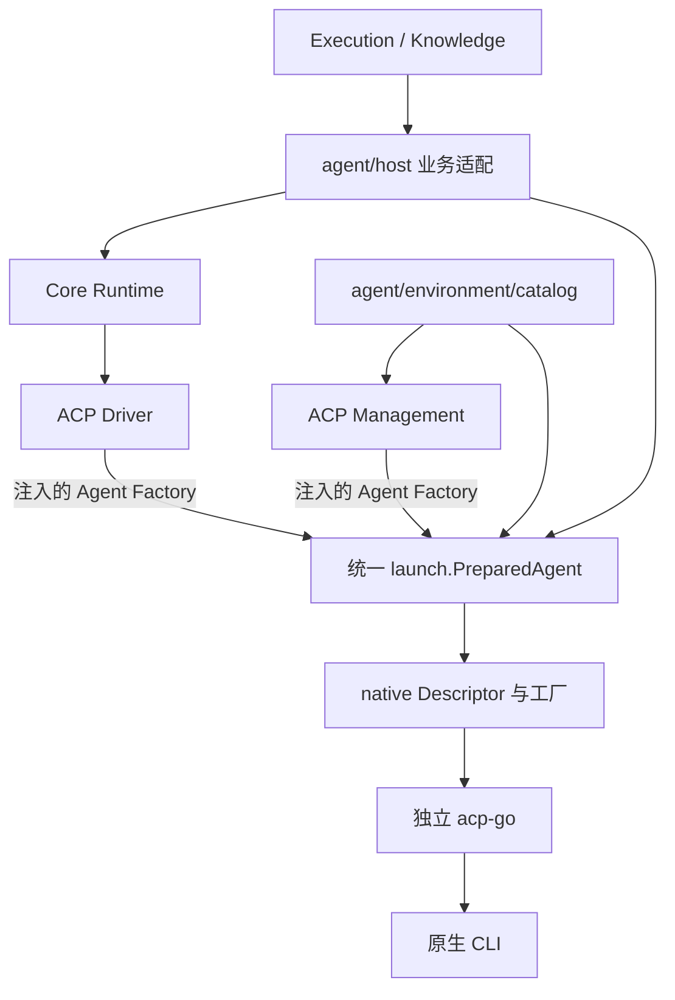

# Agent 执行内核

`server/internal/agent/core` 负责技术调用、会话、交互、输出与资源租约，属于 `server` 主 Go 模块，没有独立 `go.mod`。它不拥有 Chat、伙伴、团队、Workflow、知识内容或产品数据库，也不提供 Runtime HTTP 服务。

普通聊天、团队、工作流、自动任务和 IM 通过共用 Execution 与 `agent/host` 接入；知识生成与独立 Wiki 维护通过 Host 的独立调用入口接入。当前职责和目录依据见[会话模型 Spec](../../../../docs/discussions/agent-runtime-boundaries-spec-cn.md)，产品边界见[智能体与账号](../../../../docs/architecture/runtimes-and-accounts-cn.md)。

## 目录与依赖

| 目录                | 职责                                                                          |
| ------------------- | ----------------------------------------------------------------------------- |
| `contract`          | 静态计划、本轮输入、实际资源、原生句柄、事件、结果及 Driver 合同              |
| `runtime`           | 直接实现唯一技术会话、Prepare/Bind/Run、事件交付、兼容和释放；没有转发 facade |
| `internal/plan`     | 冻结配置、有效权限、资源冲突及本轮输入规则                                    |
| `internal/output`   | 按消息身份收集有界最终候选，没有最终证据时报告不可用                          |
| `driver/acp`        | 公开 ACP 协议转换、会话及独立 Management 操作                                 |
| `driver/acp/native` | 唯一 CLI Descriptor 注册表、语义模式候选与原生工厂                            |

依赖方向为 `runtime → contract/plan/output`、`driver/acp → contract + 外部 ACP`。内核只依赖自身包及技术依赖，不导入 Host、Environment、产品 `constants`、`status_error` 或数据库。Host 在组合边界注入 Driver 和资源端口，Runtime 不导入具体 Driver。包依赖由[定向架构测试](../dependencies_test.go)保护；原生协议和进程实现继续在独立 acp-go 仓库维护并通过 `server/go.mod` 固定版本。

## 会话准备与执行

先 New 冻结配置，再 Start 开放接纳。唯一流程是 `Prepare → 冷取得资源 → Bind → PreparedRun.Run/Close`。Prepare 在既有会话锁内占位并判断兼容，不调用资源 Factory，不启动进程。调用方立即登记 defer Close，用准备 Context 顺序取得资源，再通过 Bind 交接，包括获取失败的部分结果。Bind 不提交模型输入；Run 才打开原生连接并提交本轮输入。

SessionPlan 保存静态技术选择、工作范围、能力、资源版本及权限；TurnInput 保存本轮正文、资源选择、唯一历史播种、预算及交互/输出策略；SessionResources 保存实际 Plan、Driver、资源租约和启动凭据。SessionDirective 只带新建/恢复模式与真实 NativeHandle，恢复直接交付该句柄，不构造或返回 Checkpoint，不用摘要再次证明自己刚编译的计划。本轮数据不参与静态兼容摘要，实际资源不得改写本轮输入。新会话只播种一次有界历史，热续聊及冷恢复仅发送新增内容。

普通聊天声明持久消费者，成功且支持热复用时保留；独立任务声明临时消费者，本轮结束关闭。只读交接强制关闭，资源返回值不能解除该约束。公开 Runtime 使用同一准备和执行协议。

Acquire 期间 Cancel 或 Runtime.Close 取消准备 Context，并有界等待资源交还；迟到的资源仍由首次冷 Bind 交给同一所有者。成功 Bind 后解除短准备 Context 的转发，热准备返回前完成同样交接，后续 Run Context 拥有执行取消。重复 Bind 或显式 Close 后继续交接属于调用方违约，不新增清理所有者。未提交冷准备回收，未提交热准备保留原消费者。Host 只关联工作区与 Runtime，不保存技术状态镜像。

CloseIdle 在唯一锁下检查资源标签，活动调用返回 Busy，闲置消费者统一关闭。调用身份由 Runtime 在 Prepare 时生成，仅用于本轮事件归属。取消沿准备与执行 Context 传播；不维护身份预留表，也不提供第二条按预留身份取消的路径。

宿主可在 Config 注入标准 Logger 记录原生初始化与输入接纳耗时；诊断不增加规范事件、消息或业务回调。完整阶段定义见[聊天阶段耗时](../../../../docs/architecture/chat-and-execution-cn.md#阶段耗时)。

## 启动、认证与释放

`agent/environment/config` 提供安装、探测和启动中立值类型，`catalog` 解释本地目录及 Probe/Fork，`launch` 是原生启动与认证资源的唯一入口。Host 和 Catalog 将冻结事实及 Refresh、可重试 Release 回调交给 `launch.Prepare`；`PreparedAgent.New` 使用唯一 native 工厂。CLI 的完成策略、模式候选、配置 ID、传输和技术能力只通过 `native.Lookup` / `native.Descriptors` 读取。



Runtime 唯一持有资源与凭据租约。热会话仍有消费者时不能在回合结束处释放资源；临时会话和非热 Driver 在调用结束后释放。关闭先停止接纳、取消并等待活动调用，再关闭原生使用者。原生退出成功后，启动资源先停止 Broker 并等已接纳刷新持久化，再对账系统文件、释放账号和目录。系统账号以原生认证文件为权威，受管账号以 AIAccount 数据库凭据为权威，启动器不复制业务事实。

任何关闭阶段失败都保留同一所有者与依赖租约，后续只重试清理；已成功释放的阶段不重复执行。清理故障不能抹去已经执行的事实，也不能触发自动换引擎重跑。外部 Driver、Provider、Observer 和交互实现必须遵守传入 Context 的取消及期限。

Probe 和 Fork 使用独立 ACP Management 短连接，不进入模型循环。它们与聊天和独立任务共用启动器及认证租约；Management 关闭失败时仍保留原生所有者，不能提前归还账号或删除目录。

## 输入与结果

工具与原生配置在 SessionPlan 表达，输出和交互在 TurnInput 表达；Host 按业务选择策略，知识纯生成允许 CLI 自有工具行为。工作目录只表示原生 cwd，不证明操作系统目录沙箱。

Instructions 与 Skills 使用冻结贡献构造首次 Prompt 前缀；技能正文不复制入 Prompt，资源文件由宿主租约拥有。已物化原生指令的普通聊天使用空文本前缀策略，避免重复注入。MCP 连接通过资源租约交付，附件按实际原生能力编码；模型、推理和权限模式通过公开配置目录及回执验证。

Driver 消费 acp-go 的公开消息身份与完成事实。Codex 使用 `CompletionNativePhase`，只有真实 final 阶段才能成为严格结果；其余 CLI 使用 `CompletionLastAssistant`，在 Prompt 成功返回并排空通知后确认最后有效助手消息。后续工具、思考或过程活动会使旧候选失效。两种证明分别记为 `verified_phase` 与 `verified_driver_completion`，不混称原生 final。

执行状态、输出状态、交付故障与清理故障分别返回。原生调用完成但缺少最终证据时，执行可以是 completed，输出仍为 output_unavailable；Host 负责将结果转换为所属领域的业务终态。知识纯生成只消费最终正文，不主动注入 AGENTS.md、Skill 或 MCP，也不接管 CLI 自有工具和配置加载。

## 定向验证

从仓库根进入 `server`，按修改范围选择实际受影响包：

```sh
cd server
GOWORK=off go test ./internal/agent -run '^TestRuntimeDependencyBoundaries$' -count=1
GOWORK=off go test ./internal/agent/core/runtime ./internal/agent/core/driver/acp -count=1
GOWORK=off go test -race ./internal/agent/core/runtime ./internal/agent/core/driver/acp -count=1
```

真实 CLI 用例需显式设置对应的 `NEUX_RUNTIME_<CLI>_CLI` 为本机程序路径，Pi 另需桥接资源；未配置会跳过。受控进程、FakeDriver、本地 ACP 传输和虚构 Provider 的自动化证据不能替代真实账号、模型、平台与视觉验收。历史版本的实际运行记录见[全 CLI 接入记录](../../../../docs/discussions/agent-runtime-all-cli-plan-cn.md)，不表示当前构建已重新验收。
